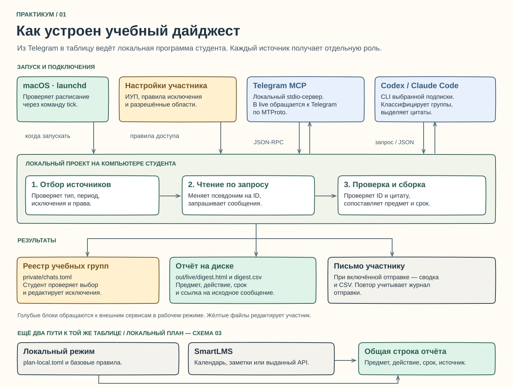

# Учебный дайджест ВШЭ на macOS

**Научитесь собирать личную таблицу заданий из учебных чатов и Smart LMS.** На занятии вы подключите Telegram MCP и пройдёте два маршрута. Для настоящей группы по умолчанию действует локальный разбор на Mac. Подписочный агент ChatGPT или Claude отрабатывает отбор и извлечение на вымышленных диалогах. Готовая сводка открывается с диска, а по расписанию приходит на вашу почту вместе с CSV.

**Начните с [пошаговой методички по macOS](docs/macos.md).** Она рассчитана на человека, который впервые открывает Терминал. Для группы «Семинар наставника» предусмотрен локальный сценарий. MCP получает разрешённые данные из Telegram на ваш Mac, Python извлекает срок по правилам, в сводку попадает обобщённая формулировка без имён участников. Для этой операции подписка не нужна. Передача сообщений настоящей группы подписочной модели включается отдельно и требует документированного основания и согласий.

| Что студент делает сам | Что должно получиться |
|---|---|
| Находит текущие предметы в ИУП; вносит названия и сокращения | Справочник дисциплин для этого учебного периода |
| Подключает [публичный Telegram MCP](https://github.com/daniil-novel/telegram-mcp/releases/tag/v0.2.2) к программе и проверяет список инструментов | Работающее локальное соединение, Telegram в режиме чтения |
| Выбирает окно переписки, курс и область разрешения; запускает агентный отбор | На диске появляется список учебных чатов, который можно открыть и исправить |
| Для живой группы поручает модели подготовить правила по встроенным вымышленным примерам через `python digest.py plan-local` | План в `private/plan-local.toml` применяется на Mac. Провайдер получает только учебные примеры и словарь |
| Добавляет запрет по ID или выражению, меняет предел просмотра | Следующий запуск соблюдает правку, случайно выбранный чат не возвращается |
| Запускает извлечение, проверяет цитату и дату открытия первоисточника | Локальная таблица с предметом, поручением, сроком и источником. Противоречивые и неполные даты помечены |
| Выбирает дни доставки и время; проверяет письмо самому себе | Сводка доступна в теле письма и в CSV-вложении |

## Что именно строим

В агентном сценарии два прохода отвечают на разные вопросы. В первом модель получает ограниченный список кандидатов, запрашивает разрешённые фрагменты и соотносит чаты с предметами. Результат записывается на компьютере. Во втором проходе программа читает только подходящие источники, а ответ модели проверяет по тексту сообщения. Человек может исключить чат до обращения к модели. В локальном сценарии решение о чтении принимает студент, а обработку выполняет программа на Mac. [Архитектура и последовательность вызовов в Excalidraw](docs/diagrams/README.md)

Персональный ИУП и расписание нужны для выбора дисциплин. Задания берутся из разрешённых переписок, собственного конспекта карточки Smart LMS, календаря или доступного вам API. Таблица отражает содержимое этих источников. Время лекции, обсуждение возможного переноса или фраза «к пятнице» сами по себе не устанавливают точную дату сдачи. [Сервисы ВШЭ и подключения — в методичке](docs/macos.md)

## Сколько времени заложить

Ориентир на первый самостоятельный проход — **18 астрономических часов**, обычный диапазон **15–20**. Базовый маршрут семинара рассчитан на **10–12 часов**, включая демонстрацию. Ниже базовые 11 часов входят в полные 18.

| Этап | Основа, ч | Первый полный проход, ч | Что сдавать |
|---|---:|---:|---|
| Разобраться в схеме, установить инструменты и запустить учебный MCP | 2 | 3 | Отчёт проверки соединения |
| Подготовить предметы, область разрешений и настройки отбора | 2 | 3 | Пример TOML с вымышленными идентификаторами |
| Пройти от списка чатов до извлечения и проверить спорные строки | 3 | 4 | Учебный CSV и сверка с первоисточником |
| Настроить почту и календарь запусков | 2 | 3 | Проверка отправки себе и ближайших дат |
| Изменить правила, разобрать один отказ и записать демонстрацию | 2 | 5 | Сравнение до и после, объяснение одного ограничения |
| **Всего** | **11** | **18** | |

Для группы из двух человек один участник на первом проходе следит за разрешениями и источниками, второй — за извлечением и доставкой. Затем поменяйтесь ролями и попробуйте объяснить друг другу путь одной строки.

## Как пользоваться репозиторием

- [Методичка по macOS](docs/macos.md) ведёт от пустой папки до запуска по расписанию, объясняет команды и даёт критерии проверки.
- [Схемы и редактируемые файлы Excalidraw](docs/diagrams/README.md) пригодятся для разбора архитектуры и защиты.
- [Путеводитель по исходному коду](docs/README.md) показывает, как одна строка проходит через модули, и где изменить правила.
- [Шаблон основной конфигурации](templates/study.toml) и [шаблон списка чатов](templates/chats.toml) содержат подсказки TODO. При настройке редактируйте личные копии, созданные командой инициализации.
- [Архив практикума для Windows](docs/legacy/windows/README.md) относится к прежней версии с другим способом подключения Telegram и отдельными настройками. Там доступна ссылка на точно соответствующие исходники.
