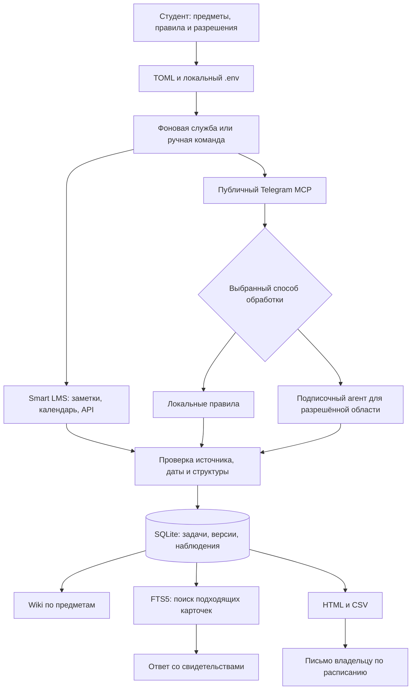
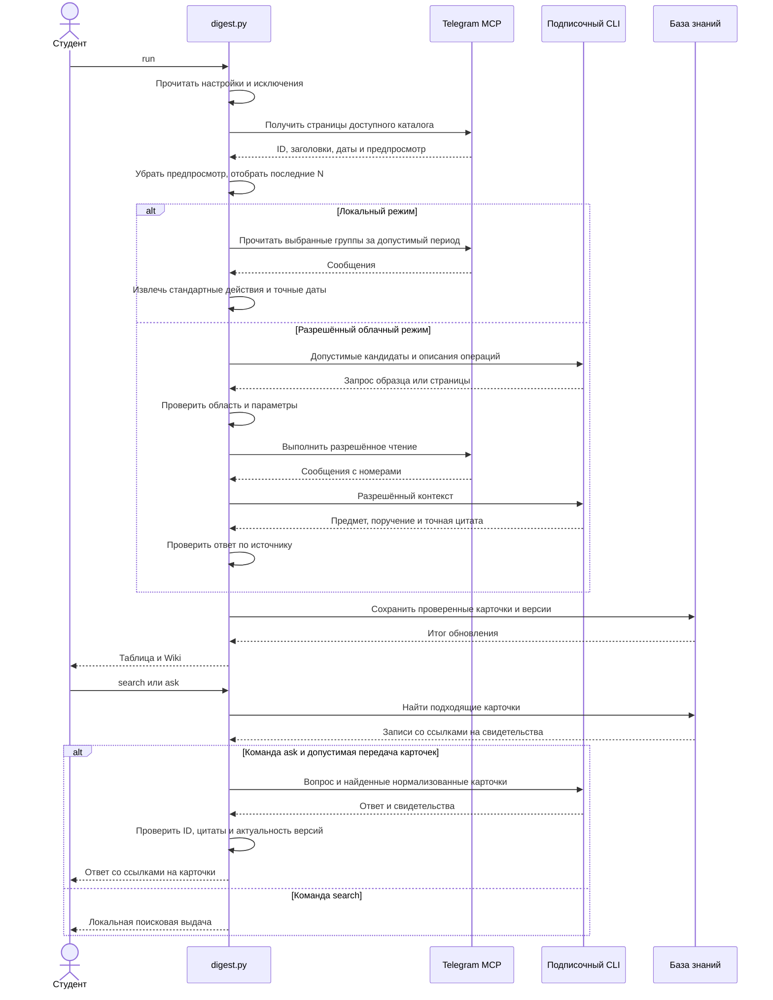

# Учебный дайджест ВШЭ. Практикум по построению агентного пайплайна

Этот практикум помогает собрать учебные поручения из доступных вам Telegram-групп и Smart LMS в одну личную базу. После настройки вы получите таблицу заданий, историю изменения карточек, Wiki по предметам, поиск по собранным сведениям и ответы со ссылками на найденные записи. Фоновая служба будет обновлять базу, пока компьютер включён, а сводка может приходить на вашу почту в выбранные дни.

**Основная инструкция ниже рассчитана на Windows.** Здесь разобраны установка программ, регистрация Telegram-клиента, команды и проверка результата. Пользователям Mac нужно начать с [установки и автозапуска для macOS](docs/macos.md), затем выполнять общие шаги этой методички. Все рабочие примеры используют ваш настоящий доступный источник. Начните с одного предмета и одной группы.

Это учебная инженерная работа на готовом исходном коде. Вы разберёте его, подключите собственные источники, измените правила и проверите корректность обновления базы. На полный первый проход с освоением инструментов и самостоятельной доработкой заложите **18–24 астрономических часа**. Основу занятия можно ограничить **10–12 часами**, оставив расширение правил, API и подробный анализ ошибок для самостоятельной работы. Разработка всей системы с нуля в эту оценку не входит.

## Содержание

1. [Что получится и как устроен пайплайн](#1-что-получится-и-как-устроен-пайплайн)
2. [Установка Python и проекта в Windows](#2-установка-python-и-проекта-в-windows)
3. [Файлы настройки и секреты](#3-файлы-настройки-и-секреты)
4. [Подписка ChatGPT или Claude и готовые навыки](#4-подписка-chatgpt-или-claude-и-готовые-навыки)
5. [Подключение настоящего Telegram MCP](#5-подключение-настоящего-telegram-mcp)
6. [Предметы из ИУП, разрешённые и исключённые чаты](#6-предметы-из-иуп-разрешённые-и-исключённые-чаты)
7. [Первый сбор и проверка по источнику](#7-первый-сбор-и-проверка-по-источнику)
8. [Smart LMS, календарь и собственные записи](#8-smart-lms-календарь-и-собственные-записи)
9. [Версии задач, Wiki и поиск с подтверждениями](#9-версии-задач-wiki-и-поиск-с-подтверждениями)
10. [Отправка себе и расписание писем](#10-отправка-себе-и-расписание-писем)
11. [Постоянная работа и запуск после входа в Windows](#11-постоянная-работа-и-запуск-после-входа-в-windows)
12. [Как самостоятельно доработать и сдать практику](#12-как-самостоятельно-доработать-и-сдать-практику)
13. [Диагностика и остановка](#13-диагностика-и-остановка)
14. [Команды и файлы программы](#14-команды-и-файлы-программы)

## 1. Что получится и как устроен пайплайн

Представьте знакомую ситуацию. Объявление о работе пришло в группу, затем преподаватель уточнил дату, а отметку о выполнении вы сделали у себя. Пайплайн должен связать таблицу с её источниками, сохранить изменения одной карточки и дать найти материал повторно. При повторном сборе ранее отмеченная задача сохраняет статус. Если две независимые записи похожи по смыслу, программа сохраняет различие между их источниками. Студент сверяет спорные случаи по оригиналам.

| Результат | Для чего нужен |
|---|---|
| Локальная HTML-таблица и CSV | Быстро просмотреть поручения и проверить даты |
| SQLite-база с версиями | Хранить карточки и прежние наблюдения между запусками программы |
| Wiki Markdown по предметам | Читать сведения по курсу в удобных связанных файлах |
| Локальный полнотекстовый поиск | Найти нужные записи по словам без загрузки всей переписки в модель |
| Ответ подписочной модели с перечнем свидетельств | Получить объяснение на основе допустимых найденных карточек и проверить его |
| Фоновая служба и её состояние | Обновлять знания с заданным интервалом и видеть ошибки последнего запуска |
| Письмо самому себе | Получить таблицу по отдельно выбранному расписанию |

В локальном режиме текст Telegram обрабатывается на вашем компьютере. Правила ищут признаки поручения и даты, а в строку отчёта подставляется стандартное описание действия. Такое извлечение ограничено словарём и выражениями. Оно может пропустить непривычную формулировку, текст на картинке, голосовое сообщение или неоднозначное объявление.

Для разрешённых источников предусмотрен облачный режим. Подписочная модель выбирает доступные фрагменты, соотносит чат с дисциплиной и выделяет поручения. Программа проверяет номер сообщения и цитату. Условие доступности чата в Telegram и условие передачи его содержания провайдеру модели проверяются отдельно. В настройках живого облачного режима фиксируются документированные основания и действующие согласия. [Условия использования контента Telegram](https://telegram.org/tos/content-licensing)



[Скачать архитектуру в SVG](docs/diagrams/architecture.svg) · [исходный Mermaid](docs/diagrams/architecture.mmd).

Проход агента тоже можно проследить по операциям. Модель предлагает допустимый вызов, а выполняет его код, который проверяет доступ и параметры.



[Скачать последовательность в SVG](docs/diagrams/sequence.svg) · [исходный Mermaid](docs/diagrams/sequence.mmd). Файлы SVG собраны официальным Mermaid CLI; порядок их обновления описан [рядом со схемами](docs/diagrams/README.md).

В методическом материале «Разработка и применение мультиагентных систем в корпоративной среде» обсуждаются инструменты, память, выполнение и расширение контекста. Здесь эти идеи реализованы в небольшом учебном приложении. Wiki Markdown и выбор SQLite с FTS5 — решения этого проекта. Соответствие страниц руководства и функций разобрано в [карте методики](docs/guide-mapping.md).

## 2. Установка Python и проекта в Windows

### 2.1. Установите Python

1. Откройте официальную страницу Python для Windows. Установите **Python install manager**, если Python ещё отсутствует. Если на компьютере уже работает Python 3.11 или новее, его можно использовать.
2. После установки закройте старые окна терминала. Откройте меню «Пуск», введите **cmd**, нажмите Enter. Откроется «Командная строка». В этой методичке команды Windows даны для неё.
3. Введите `python --version` и нажмите Enter. Вы должны увидеть номер Python 3.11 или новее. Если менеджер установлен, но сама версия Python ещё не появилась, выполните `py install 3.13` и повторите проверку. `py` запускает менеджер Python, `install` означает установку, `3.13` выбирает совместимую ветку. После установки откройте новое окно.
4. Если `py` сообщает, что подкоманда `install` неизвестна, у вас старый launcher. Установите актуальный менеджер по ссылке либо используйте уже установленный Python нужной версии. [Python для Windows](https://www.python.org/downloads/windows/) · [Документация установки](https://docs.python.org/3/using/windows.html)

### 2.2. Скачайте исходники

1. Откройте репозиторий. Нажмите **Code → Download ZIP**.
2. В Проводнике щёлкните скачанный архив правой кнопкой и выберите **Извлечь всё**.
3. Создайте в своей пользовательской папке каталог `StudyDigest`. Переместите в него файлы распакованного проекта. Откройте каталог. В нём должны находиться `digest.py`, `README.md`, `requirements-mcp.txt` и папка `agent_code`.
4. Щёлкните адресную строку этой папки в Проводнике, напишите `cmd` и нажмите Enter. Командная строка откроется сразу в нужном месте.
5. Введите `dir`. Команда показывает содержимое текущей папки. Если `digest.py` не видно, вернитесь в Проводник и откройте папку, в которой он действительно лежит. [Репозиторий проекта](https://github.com/daniil-novel/hse-study-digest)

### 2.3. Создайте окружение и установите зависимости

Выполняйте строки по одной. Вводите только саму команду. Имя диска и знак `>` слева уже показывает Windows.

```bat
python -m venv .venv
.venv\Scripts\activate
python -m pip install -r requirements-mcp.txt -r requirements-calendar.txt
python digest.py init
```

| Часть команды | Что она означает |
|---|---|
| `python` | Запускает выбранный Python |
| `-m venv` | Просит Python выполнить модуль создания отдельного окружения |
| `.venv` | Папка с библиотеками именно этой копии проекта |
| `.venv\Scripts\activate` | Настраивает текущее окно cmd так, чтобы команда `python` использовала окружение проекта |
| `-m pip install` | Запускает установщик библиотек из этого Python |
| `-r requirements-mcp.txt` | Берёт первый список зависимостей, включая публичный пакет Telegram MCP |
| `-r requirements-calendar.txt` | Дополнительно ставит зависимости для календаря |
| `digest.py init` | Создаёт ваши настройки и закрытые рабочие файлы по шаблонам |

После активации в начале строки обычно появляется `(.venv)`. Когда в следующий раз откроете новое окно cmd из папки проекта, сначала снова выполните `.venv\Scripts\activate`. Повторная установка библиотек нужна при обновлении зависимостей. Повторный `init` предназначен для дополнения отсутствующих файлов и сохраняет существующую настройку.

Проверьте `python digest.py --help`. Флаг `--help` выводит список команд. Затем выполните `where telegram-mcp`. Команда `where` показывает путь установленного сервера; нужный путь должен находиться внутри вашей `.venv\Scripts`.

## 3. Файлы настройки и секреты

Откройте корень проекта в Проводнике. Включите **Вид → Показать → Расширения имён файлов**, чтобы отличать `.env` от `.env.txt`. После инициализации используются два основных файла.

| Файл | Что в нём хранится | Как открыть |
|---|---|---|
| `private/study.toml` | Предметы, режим обработки, предел выборки, расписание, параметры службы | `notepad private\study.toml` |
| `.env` в корне проекта | Значения доступа Telegram и почты, при необходимости токен Smart LMS | `notepad .env` |
| `private/chats.toml` | Выбранные группы, запреты и история ручного выбора | `notepad private\chats.toml` |

`notepad` открывает Блокнот, а следующий аргумент указывает файл. Сохранение — **Ctrl + S**. Кодировка — UTF-8. В TOML символ `#` начинает комментарий для человека. Строки `# TODO` подсказывают место вашей настройки. Заголовок в квадратных скобках открывает раздел. Имя слева от `=` — параметр, справа — значение. Строки заключают в кавычки, числа и `true`/`false` пишут без кавычек.

`.env` — обычный локальный файл вида `ИМЯ=значение`. Заполните уже имеющиеся строки по подсказкам шаблона. Telegram API ID и API hash получите на следующем шаге. SMTP-пароль нужен только для отправки письма. OAuth-вход подписочного CLI и Telegram-сеанс сохраняются штатными механизмами соответствующих программ в отдельных локальных файлах. Не переносите содержимое этих сеансов в `.env`.

Файл `.env`, папки `private` и `out` содержат личные данные. Они исключены из Git. При ручной отправке архива проверяйте его состав отдельно. Для совместной сдачи достаточно исходников, заполненного описания эксперимента и разрешённых результатов.

## 4. Подписка ChatGPT или Claude и готовые навыки

Локальный сбор можно провести без модели. Для обработки разрешённого материала и генерации ответов выберите один CLI — клиент, который можно запускать из терминала. Пайплайн использует его штатный вход по подписке. Лимиты выбранного плана действуют и для таких запусков.

| Действие | Codex через ChatGPT | Claude Code |
|---|---|---|
| Установить | Установите Node.js LTS с официального сайта. Откройте новое окно cmd в папке проекта, активируйте окружение и выполните `npm install -g @openai/codex` | Выполните `winget install Anthropic.ClaudeCode`. Если Windows не находит winget, используйте официальный установщик Claude Code |
| Проверить | `codex --version` | `claude --version` |
| Войти для пайплайна | `python digest.py auth codex`, затем в браузере выберите вход с ChatGPT | `python digest.py auth claude`, затем завершите вход с аккаунтом Claude.ai |
| Настроить провайдера | В `[agent]` укажите `provider = "codex"` | В `[agent]` укажите `provider = "claude"` |
| Установить проектные навыки | `python digest.py install-skills codex` | `python digest.py install-skills claude` |

`npm` — установщик из комплекта Node.js. Подкоманда `install` устанавливает пакет, `-g` делает команду доступной вашему пользователю, `@openai/codex` — имя пакета. `winget` — менеджер программ Windows, `Anthropic.ClaudeCode` — идентификатор приложения. Команда `auth` выполняет вход в профиль практикума. `install-skills` копирует три навыка в каталог проекта для выбранного клиента. [Node.js](https://nodejs.org/en/download) · [Codex CLI](https://developers.openai.com/codex/cli/) · [Вход в Codex](https://developers.openai.com/codex/auth/) · [Claude Code](https://code.claude.com/docs/en/setup) · [Вход Claude Code](https://code.claude.com/docs/en/authentication)

**Что такое навык.** Это файл инструкции для агента, описывающий назначение команды, вход и проверку результата. Навык помогает последовательно применять инструменты проекта. Реальные сведения хранит база знаний. При прямом запуске Python программные инструкции модели и проверки ответа задаются кодом пайплайна.

| Навык | Когда пригодится |
|---|---|
| `study-collector` | Собрать выбранные источники, проверить происхождение и обновить данные |
| `study-search` | Найти карточки и сформировать ответ с подтверждениями |
| `study-maintainer` | Проверить состояние службы, настройки и исправить понятный сбой |

Для работы через интерактивного агента запускайте `codex` или `claude` **из корня проекта**. Так он обнаружит проектные навыки в `.agents/skills` либо `.claude/skills`. Поручение можно сформулировать своими словами, например попросить применить `study-search` к уже собранной базе по интересующему предмету. До включения передачи данных модели ознакомьтесь с правилами обработки источника и разделом про `ask`. Срок действия OAuth может закончиться; тогда повторите команду `auth`.

## 5. Подключение настоящего Telegram MCP

MCP позволяет программе вызывать инструменты сервера. В этой практике используется публичный пакет `daniil-novel/telegram-mcp`. Он работает локальным процессом, а к Telegram подключается с вашей авторизацией. Python обращается к нему через стандартные потоки ввода и вывода процесса, режим **stdio**. Сервер предоставляет чтение каталога и сообщений. [Публичный выпуск и инструкция автора](https://github.com/daniil-novel/telegram-mcp/releases/tag/v0.2.2)

### 5.1. Получите API ID и API hash

1. В браузере откройте официальный кабинет `my.telegram.org`.
2. Введите номер своего Telegram в международном формате и подтвердите вход способом, указанным на сайте.
3. Откройте **API development tools**. Если приложение уже создано, используйте его реквизиты. Иначе заполните обязательные поля, например задайте собственное название `StudyDigest`, краткое латинское имя и тип Desktop, если он предлагается.
4. Скопируйте **api_id** и **api_hash** непосредственно в свои локальные настройки. API ID — число, API hash — секретная строка. Кода входа, пароля двухэтапной проверки или токена BotFather эти поля не заменяют. [Кабинет Telegram](https://my.telegram.org/) · [Официальная процедура](https://core.telegram.org/api/obtaining_api_id)

### 5.2. Заполните .env и войдите

Выполните `notepad .env`. Заполните `TELEGRAM_API_ID` и `TELEGRAM_API_HASH`. Оставьте `TELEGRAM_WRITE_ENABLED=false`. Список разрешённых ID задаёт `TELEGRAM_ALLOWED_CHAT_IDS`, список запрещённых — `TELEGRAM_DENIED_CHAT_IDS`. Несколько номеров разделяются запятыми.

Для первого просмотра своего локального каталога можно использовать `TELEGRAM_ALLOWED_CHAT_IDS=*`. Звёздочка разрешает upstream-серверу перечислять доступные вашей учётной записи диалоги, включая предпросмотр последнего сообщения. После просмотра сузьте список до нужных групп. Если ID нужной группы уже известен, укажите его сразу. Пустой разрешающий список закрывает все чаты.

В `private/study.toml` проверьте `[mcp].enabled = true`, `executable = "telegram-mcp"` и путь к корневому `.env` по созданному шаблону. Если команда сервера не находится, подставьте полный путь, который показал `where telegram-mcp`, в одинарных кавычках TOML. Они сохраняют обратные косые черты Windows.

```bat
python digest.py telegram-login
python digest.py doctor
python digest.py inventory
```

- `telegram-login` запускает штатную команду `auth` публичного MCP. Введите номер, код и при необходимости пароль 2FA непосредственно в своём терминале. При скрытом вводе звёздочки могут отсутствовать.
- `doctor` проверяет соединение и наличие инструментов чтения. Успешный результат ещё не подтверждает чтение конкретной группы.
- `inventory` сохраняет каталог в `private/dialogs.csv`. Откройте его в Блокноте или импортируйте в Excel. Для ID используйте текстовый тип, чтобы Excel не округлил длинный номер.

После входа пароль и код повторно на каждом сборе не спрашиваются. Для отзыва устройства используйте **Telegram → Настройки → Устройства**. Если сессия истекла, повторите `telegram-login`. Папка сессии и файл секретов должны оставаться доступны именно тому пользователю Windows, от которого работает программа.

## 6. Предметы из ИУП, разрешённые и исключённые чаты

### 6.1. Найдите текущие дисциплины

Откройте iStudy, выберите вход через ЕЛК и роль студента, затем электронную зачётную книжку. Проверьте учебный год и предметы своего текущего модуля. При индивидуальных изменениях уточните утверждённый план в учебном офисе. Для сверки названий пригодится персональное расписание в личном кабинете ВШЭ или HSE App X. Приложение позволяет подписаться на календарь занятий. Время пары помогает ориентироваться в учебном периоде; срок сдачи подтверждается карточкой задания или объявлением. [iStudy](https://istudy.hse.ru/) · [ИУП](https://www.hse.ru/studyspravka/plan/) · [Электронная зачётка](https://www.hse.ru/studyspravka/zachetbook) · [Личный кабинет](https://lk.hse.ru/) · [Расписание ВШЭ](https://economics.hse.ru/support/timetable)

В `private/study.toml` найдите раздел `[courses]`. В нём слева в кавычках пишут полное название предмета, справа в квадратных скобках — сокращения и варианты. Перенесите свои актуальные дисциплины. Один и тот же заголовок секции вставляется только один раз.

Ниже форма настройки для уже известной учебной группы. Замените левую часть на название своей группы, правую — на название своего предмета из `[courses]`.

```toml
[courses]
"Семинар наставника" = ["семинар наставника"]

[agent]
provider = "codex"
mode = "local"

[local]
auto_match = false

[local.chat_titles]
"Семинар наставника 25/26" = "Семинар наставника"

[local.chat_ids]

[local.task_regex]
```

В живом файле уже есть эти секции. Исправляйте поля в них, сохраняя остальные настройки. `mode = "local"` оставляет разбор на компьютере. `auto_match = false` означает отбор по явно указанным ID, точным названиям и уже сохранённому реестру. Для автоматического сопоставления по единственному подходящему названию курса можно позже включить `true`.

### 6.2. Ограничьте выборку и сохраните список

В разделе `[scan]` выберите `max_dialogs = 350`. Можно поставить 300 или 400. Это число последних по активности доступных диалогов, из которых выбираются группы. `page_size` задаёт размер одного ответа MCP, а `sample_size` — объём образца для облачного отбора. Правило активности использует два календарных месяца. Например, от 4 ноября граница проходит по 4 сентября.

Поставщик MCP возвращает каталог в своём порядке. Чтобы определить последние N, программа читает доступные страницы, локально удаляет текст предпросмотра, сортирует по времени и ограничивает результат. Поэтому N ограничивает набор кандидатов, а не гарантирует чтение ровно N записей upstream. Для ограничения самого сервера используйте его разрешающий список ID.

Выполните `python digest.py discover`. В локальном режиме программа сопоставит группы по заданным правилам. Откройте `private/chats.toml`.

| Раздел реестра | Как с ним работать |
|---|---|
| `[tracked]` | ID группы связан с предметом. Проверьте каждую строку, удалите лишнюю |
| `[titles]` | Человекочитаемые названия помогут найти группу по ID |
| `[exclude].ids` | Номера чатов, которые сбор должен исключить |
| `[exclude].title_regex` | Выражения для исключения названий, например архивных групп |
| `[history].seen` | История предыдущего выбора, благодаря которой удалённая вручную группа не возвращается автоматически |

Для запрета номера пишите его в кавычках вместе с минусом. Для названий возможна настройка `title_regex = ['(?i)архив']`. Здесь `(?i)` снимает различие между буквами верхнего и нижнего регистра. Начните с понятного слова. Широкое выражение может исключить нужную группу. Для сознательного возврата ручного удаления нужно проверить и `seen`, и явные запреты. Список ID upstream и реестр пайплайна действуют совместно.

### 6.3. Если выбран облачный разбор

Для `mode = "cloud"` программа использует выбранную подписку. Передача чужой переписки модели требует основания для конкретного контента и контекста. В конфигурации предусмотрены провайдер, период, срок действия, состав и ссылки на подтверждения в `private/telegram-scopes.toml`. Техническая запись фиксирует проверку человеком и сама не создаёт разрешение. При отзыве, изменении состава или неизвестном авторе обработку этой области нужно остановить. Источники, отмеченные локальными, продолжают относиться к локальной области. [Telegram Content Licensing](https://telegram.org/tos/content-licensing) · [Telegram API Terms](https://core.telegram.org/api/terms)

Откройте файл командой `notepad private\telegram-scopes.toml`. `init` уже оставил в нём пояснения формата. Заполняйте область только по фактически проверенным основаниям:

| Поле области | Что требуется |
|---|---|
| `[scope."ID"]` | Настоящий ID конкретной группы из вашего каталога |
| `provider` | Именно тот провайдер, которому разрешено передать материал: `codex` или `claude` |
| `status` | `active` только при действующем основании; при отзыве обработку остановите |
| `start`, `end` | Начало и конец разрешённого периода сообщений в ISO-формате с часовым поясом |
| `valid_until` | Момент, до которого действует подтверждение области |
| `content` | Подтверждённый состав: `title_and_messages` |
| `platform_permit` | Ссылка или номер конкретного допустимого исключения из условий платформы для этого использования |
| `complete_roster` | Подтверждение человеком полноты охваченного состава, а не вывод программы |
| `members` | Соответствие реальных ID участников ссылкам или номерам их индивидуальных согласий |

Наличие всех строк проверяет программа; подлинность документов и допустимость контекста она не устанавливает. Пока оснований нет, продолжайте локальный маршрут. Нужное имя предмета и точный ID берутся из ваших настроек, а не из готового примера.

В этой ветке агент предлагает вызовы чтения, затем даёт обоснование предмета и точные цитаты поручений. До и после вызова программа проверяет границы. Локальный журнал выбора позволяет сверить решение. Если у вас нет оснований передавать материалы выбранной группы, используйте локальную обработку и разрешённые независимые записи Smart LMS для модельной части работы.

## 7. Первый сбор и проверка по источнику

Оставьте только один проверенный предмет и одну подходящую группу. Выполните команду.

```bat
python digest.py run
```

`run` проходит полный путь от настроек и источников до базы знаний и выходных файлов. В локальной ветке разбор выполняет программа. В облачной — разрешённые фрагменты обрабатывает провайдер. После успешного сбора терминал сообщает число наблюдённых, новых, изменившихся и прежних карточек.

1. Откройте `out/live/digest.html` двойным щелчком в Проводнике.
2. Найдите одно поручение, которое вы сами видите в Telegram или Smart LMS. Сверьте предмет, действие, срок и номер сообщения.
3. Откройте источник по ссылке. В частную группу нужно войти своим Telegram-аккаунтом. У некоторых типов групп прямой ссылки может не быть; используйте имя и номер сообщения.
4. Сравните HTML с `out/live/digest.csv`. Для импорта в Excel выбирайте UTF-8 и разделитель «точка с запятой».
5. Повторите `python digest.py run`. Если источники не изменились, новые версии одинаковых карточек не создаются. Время последнего наблюдения обновляется.

| Что проверить | Как интерпретировать |
|---|---|
| Указана полная дата и время | Сверьте их с оригиналом. Время свободного текста считается московским, поэтому при другом поясе нужна отдельная проверка |
| Назван только день | Часы и минуты остаются неуказанными |
| Срок выражен через «к следующей паре» или похожую фразу | Требуется уточнение. Программа не должна выдавать предположение за опубликованную дату |
| Источники содержат разные сроки | Откройте оба. Одинаковые формулировки могут помечаться как конфликт, перефразирование может дать разные карточки |
| Результат пустой | Проверьте период, исключения, наличие текста и поддерживаемую формулировку. Пустая выборка не доказывает отсутствие учебных обязанностей |
| Задача осталась из прошлого сбора | Проверьте время последнего наблюдения и состояние источника. База сохраняет известные поручения между проходами |

**Граница локального извлечения.** Оно ищет определённые слова и конструкции. Сверьте несколько реальных сообщений разных типов. Если важная формулировка пропущена, зафиксируйте пример у себя, добавьте точное правило или внесите собственную подтверждённую запись. Правило, сработавшее на одном объявлении, нужно проверить и на соседнем сообщении без поручения.

## 8. Smart LMS, календарь и собственные записи

Smart LMS ВШЭ находится на `edu.hse.ru`. Войдите через университетский экран авторизации и откройте конкретное задание курса. Найдите окончание приёма работ. Дата начала, дата семинара и срок загрузки результата могут стоять рядом. Для таблицы нужна именно дата обязательного действия. [Smart LMS ВШЭ](https://edu.hse.ru/) · [Справка ВШЭ](https://www.hse.ru/studyspravka/lms)

### Собственная запись по карточке задания

В `[lms]` поставьте `use_notes = true`. Файл `private/lms.json` содержит список ваших записей. Одна запись состоит из четырёх полей.

| Поле | Что внести из своего задания |
|---|---|
| `id` | Короткую постоянную метку. У другой работы должна быть другая метка |
| `course` | Точное название из `[courses]` |
| `text` | Вашу формулировку действия и опубликованный срок. Сначала проверьте оригинал |
| `url` | Обычную ссылку на карточку задания. Если её нет, допустима пустая строка |

JSON заключает поля и текст в двойные кавычки, объект — в фигурные, список — в квадратные скобки. Откройте `notepad private\lms.json`. Если неудобно писать JSON вручную, поручите выбранному агенту сформировать запись по введённому вами собственному описанию, затем сверьте значения с карточкой курса и сохраните локально. В содержимое, передаваемое модели, должны входить только разрешённые вам материалы.

При `mode = "local"` запись обрабатывается локальными правилами. При `mode = "cloud"` её текст получает провайдер. Чтобы собирать только Smart LMS, выключите `[mcp].enabled`. Используйте этот путь, если для Telegram нет нужного доступа.

### Календарь дедлайнов

В некоторых конфигурациях Moodle доступен **Календарь → Экспорт календаря**. Выберите события курса и нужный период. Кнопка выгрузки сохраняет файл `.ics`, а адрес подписки позволяет получать обновлённую версию при каждом сборе. Наличие экспорта в вашем аккаунте Smart LMS нужно проверить в интерфейсе. [Экспорт календаря Moodle](https://docs.moodle.org/en/Using_Calendar)

Сохраните свой файл в `private/deadlines.ics` и поставьте `calendar = "private/deadlines.ics"` в `[lms]`. Если система выдала персональную ссылку с `https://edu.hse.ru/calendar/export_execute.php?`, допустимо использовать её. Она может содержать секрет, поэтому остаётся в личных настройках. При файле обновление выполняете вы, при подписке — программа.

В заголовке, категории или описании должен распознаваться предмет. Импорт также проверяет назначение события как срока задания. Сверьте хотя бы одну запись с открытой карточкой курса, включая время. Расписание пар HSE App X помогает сверять занятия; в этот вход подключают календарь именно заданий.

### Выданный вузом доступ к REST

Если ВШЭ выдала вам токен на чтение календарных событий курса, можно использовать адаптер API. В `.env` укажите токен в `LMS_TOKEN` (поддерживается также `HSE_LMS_TOKEN`). В `[lms.api_courses]` сопоставьте номер курса из URL его карточки с названием вашего предмета. Если токена или соответствующего права нет, выберите собственные записи или календарь. Универсальная выдача такого API-токена каждому студенту в открытой документации ВШЭ не подтверждена. Подробности доступного метода видны в [адаптере Smart LMS](lms_api.py).

## 9. Версии задач, Wiki и поиск с подтверждениями

Детали схемы базы и правил обновления приведены в [главе о знаниях и поиске](docs/knowledge.md); ниже — действия пользователя.

### 9.1. Почему после перезапуска сведения сохраняются

Данные записываются в `private/knowledge.sqlite`. Это локальная SQLite-база, отдельная от процесса Python и переписки с агентом. В ней есть карточки, их версии, наблюдения и поисковый индекс.

У задачи появляется устойчивый `TASK_ID` вида `K-` и 12 символов. Версия свидетельства дополняет его суффиксом `@v1`, `@v2` и далее. Вы используете **настоящий ID из своей базы**, когда отмечаете выполнение.

| Событие | Что делает база |
|---|---|
| Повторно прочитана та же карточка того же источника | Обновляет наблюдение, не добавляя лишнюю версию |
| Содержание единственной подходящей карточки того же источника изменилось | Сохраняет прежний ID, новую версию и историю |
| Два отдельных источника похожи по формулировке | Сохраняет их отдельно, без автоматического объединения по похожести |
| Несколько изменений одного источника нельзя однозначно сопоставить | Создаёт отдельные записи, которые нужно сверить |
| После успешного непустого сбора прежняя карточка не встретилась | Отмечает, что источник не перепроверен в последнем проходе |
| Весь сбор оказался пустым | Сохраняет существующие карточки и их метки |
| Вы отметили задачу выполненной, затем изменился её срок | Сохраняет пользовательскую отметку. Проверьте, требуется ли открыть работу снова |

Перенос в **новом сообщении** может получить другую карточку. Автоматической смысловой связи между независимыми объявлениями здесь нет. Отсутствие записи в текущем окне чтения не является отменой. История базы отражает увиденные версии, а не все изменения, которые когда-либо происходили в Telegram. Этот объём можно проверить на обычном повторном сборе и на своей настоящей редактируемой заметке.

### 9.2. Откройте Wiki

```bat
python digest.py wiki
```

Команда пересобирает Markdown-страницы из существующей базы. Откройте `private/wiki/index.md` в редакторе с просмотром Markdown. Можно пользоваться VS Code, Obsidian или читать файл как текст. Индекс ведёт на страницы предметов, где видны карточки, источники, пользовательские отметки и наблюдённые версии.

Файлы предметов имеют устойчивые технические имена `course-…md`, а читаемое название стоит внутри страницы и в индексе. Wiki — локальное представление базы. Ручные исправления в автоматически созданных страницах будут заменены при следующей сборке. Исправляйте исходную запись либо используйте команды состояния задачи.

### 9.3. Найдите нужные записи

```bat
python digest.py search "семинар"
```

Замените слово на название своего предмета или часть формулировки задания. Кавычки объединяют запрос из нескольких слов в один аргумент команды. Поиск работает на компьютере через **SQLite FTS5**. Он сопоставляет слова и их начала, нормализует регистр и «ё/е», убирает часть служебных слов и ранжирует найденные карточки.

Это **лексический поиск**. Он не понимает все синонимы, словоформы и смысл вопроса. Если запрос не дал нужной записи, попробуйте слово, которое действительно встречается в карточке, либо его начало. Несколько слов соединяются по правилу «или»; вверху могут оказаться записи, подходящие только по части запроса. Сам запрос `search` и найденные карточки провайдеру не передаются.

Результат содержит поля карточки, ID, версию, состояние и ссылку. Найдите одну запись и откройте её первоисточник. Сверьте последнее наблюдение с текущим объявлением.

### 9.4. Получите ответ на основе найденного

Команда `ask` — отдельное осознанное обращение к модели. Она передаёт выбранному провайдеру **ваш вопрос и найденные нормализованные карточки**. До её использования убедитесь, что эти сведения разрешено передавать. В частности, при условии «данные этой группы остаются только на компьютере» используйте для неё `search` и Wiki. Вопрос тоже может содержать персональную информацию.

```bat
python digest.py ask "Что нужно сделать по семинару наставника?"
```

Подставьте свой настоящий вопрос. По умолчанию берётся провайдер из TOML. Чтобы выбрать другой уже авторизованный клиент, добавьте `--provider claude` или `--provider codex`. Флаг `--provider` задаёт поставщика модели для этого вопроса.

Пайплайн сначала локально ищет карточки, затем добавляет их в контекст запроса. Модель формирует ответ, а код проверяет номера свидетельств, точные цитаты и актуальность версий. Если карточки изменились, пока модель отвечала, вопрос требуется повторить. Если сведений нет или недостаточно, это должно быть отражено в результате.

Так реализован **RAG**, дополнение ответа найденными данными. В проекте поиск лексический. Эмбеддинги и отдельная векторная база для него не нужны. Наличие верной цитаты доказывает, что фрагмент взят из указанной карточки. Правильность вывода из этой цитаты студент проверяет отдельно. Из отсутствия результата поиска нельзя заключать, что преподаватель ничего не задавал.

### 9.5. Отметьте выполнение

Возьмите `TASK_ID` из своего поиска или Wiki. В командах ниже замените слово `TASK_ID` на этот ID целиком.

```bat
python digest.py done TASK_ID
python digest.py reopen TASK_ID
```

`done` отмечает работу выполненной, `reopen` снова открывает её. Выберите действие, соответствующее реальному состоянию. Эти команды меняют пользовательскую отметку в базе и обновляют Wiki. Они не меняют сообщения преподавателя. После отметки снова выполните поиск и убедитесь, что изменился только статус нужного поручения.

## 10. Отправка себе и расписание писем

Сначала просмотрите HTML и Wiki. Для письма нужен ваш почтовый ящик с SMTP поверх TLS. Для Gmail используйте доступный вашему аккаунту пароль приложения. Его создание требует включённой двухэтапной проверки, а в некоторых учебных аккаунтах администратор отключает эту возможность. [Google о паролях приложений](https://support.google.com/accounts/answer/185833?hl=en) · [Параметры SMTP Gmail](https://knowledge.workspace.google.com/admin/gmail/send-email-from-a-printer-scanner-or-app)

Откройте корневой `.env`. Заполните свой SMTP-пароль в `DIGEST_SMTP_PASSWORD`. Адрес, сервер и порт можно задать через `DIGEST_SMTP_ADDRESS`, `DIGEST_SMTP_HOST` и `DIGEST_SMTP_PORT`, если это предусмотрено шаблоном. В `[mail]` проверьте свой `address`, `host`, `port = 465` и поставьте `enabled = true`. Адрес одновременно служит отправителем и получателем. Для Gmail сервер — `smtp.gmail.com`.

```bat
python digest.py send
```

`send` собирает актуальные сведения и отправляет текущий выпуск самому себе. Откройте полученное письмо и CSV-вложение. Сравните одну строку с файлом `out/live/digest.csv`. «Сервер принял письмо» означает, что передача SMTP завершилась; доставку подтвердите во «Входящих». При необходимости проверьте «Спам» и «Отправленные».

Расписание писем задаётся в `[schedule]`. Ниже один из вариантов. В своём файле измените существующий раздел.

```toml
[schedule]
mode = "weekly"
weekdays = ["tue", "thu"]
month_days = [1, 15, -1]
times = ["09:00"]
timezone = "Europe/Moscow"
catchup_hours = 24
date_regex = ""
```

| Задача | Что изменить |
|---|---|
| Каждый день в 18:30 | `mode = "daily"`, `times = ["18:30"]` |
| Два раза в неделю | `mode = "weekly"`, выберите `weekdays` |
| Один раз в месяц, в последний день | `mode = "monthly"`, `month_days = [-1]` |
| Два раза в месяц | `mode = "monthly"`, `month_days = [1, 15]` |
| N раз в месяц | Укажите N чисел в `month_days`, например для трёх выпусков `[1, 12, 24]` |
| Дважды в выбранный день | `times = ["09:00", "18:30"]` |
| Временно ограничить конкретным периодом | Используйте `date_regex` для даты формата YYYY-MM-DD после проверки выражения |

Дни недели обозначаются `mon tue wed thu fri sat sun`. Значение `-1` — последний день месяца. Число 31 в месяце, где такого дня нет, пропускается. `timezone` определяет часовой пояс письма. `catchup_hours` задаёт окно для последнего пропущенного выпуска после сна компьютера.

```bat
python digest.py schedule
```

Команда показывает ближайшие даты и ничего не отправляет. Сравните их с календарём. Повторная отправка одного уже подтверждённого планового выпуска подавляется. При неизвестном результате SMTP автоматический повтор останавливается, поскольку письмо могло уже уйти. Прежде чем вмешиваться в журнал, проверьте свой ящик.

## 11. Постоянная работа и запуск после входа в Windows

Сбор сведений и почтовое расписание имеют разную частоту. Базу можно обновлять каждые 15 минут, а письмо получать дважды в неделю. Поля `[service]` задают работу фонового процесса.

| Поле | Значение по смыслу |
|---|---|
| `scan_interval_seconds` | Интервал очередного полного сбора в секундах. 900 секунд — 15 минут |
| `tick_interval_seconds` | Как часто проверять наступление почтового выпуска. 60 секунд — раз в минуту |
| `command_timeout_seconds` | Сколько можно ждать один дочерний запуск. Увеличьте обоснованно, если большое число групп читается дольше |

### 11.1. Проверьте один проход службы

```bat
python digest.py service --once
python digest.py status
```

`service` запускает процесс обновления. Флаг `--once` просит выполнить один реальный сбор и закончить, без отправки письма. Этот вариант проверяет подключение и сохранение результата без ожидания интервала службы. `status` показывает состояние процесса, время последнего обновления и состояние последнего действия. Сведения о здоровье сохраняются в `private/service-status.json`. [Подробное устройство службы](docs/service.md)

Затем выполните `python digest.py service` без флага. Процесс будет работать в текущем окне. Оставьте его на время одного интервала, из другого активированного окна вызовите `status` и проверьте свежесть отметки. Чтобы остановить ручной процесс, нажмите **Ctrl + C** в его окне.

### 11.2. Включите автозапуск

```bat
python digest.py install-service
python digest.py status
```

`install-service` регистрирует пользовательскую задачу в **Планировщике заданий Windows**, которая запускает процесс после входа в вашу учётную запись. На Mac эта же команда регистрирует LaunchAgent. В настройке ОС сохраняются пути к программе; секреты продолжают читаться из вашего `.env`. После переезда папки или создания нового окружения задачу нужно переустановить.

Проверка установки состоит из двух действий. Найдите созданную задачу в Планировщике, затем запустите её или выполните повторный вход в Windows и проверьте свежий `status`. Установка записи в Планировщике и работающий процесс — разные результаты. При выключенном компьютере, сне, отсутствии сети или истёкшей авторизации сбор не выполнится. После возвращения доступа программа продолжит следующую проверку по своей логике.

Для остановки автозапуска выполните `python digest.py remove-service`. Проверьте `status`. Ручной процесс, если вы отдельно запустили его в терминале, завершите **Ctrl + C** в том окне.

Локальная база хранится отдельно от процесса. Перезапуск службы сохраняет карточки и версии. Исключённый или более недоступный источник может оставить ранее увиденную карточку в базе с соответствующим временем проверки. Такой результат требует прочтения отметки свежести.

## 12. Как самостоятельно доработать и сдать практику

### Учебный план

Полный маршрут на готовом коде рассчитан на **18–24 часа**. Диапазон учитывает первые настройки аккаунтов, проверку разных источников и самостоятельную доработку. Разработка всего проекта с пустой папки в эту оценку не входит.

| Этап | Основной семинар, ч | Полный первый проход, ч |
|---|---:|---:|
| Python, зависимости, устройство программы | 2 | 2–3 |
| Авторизация MCP и предметы | 2 | 3–4 |
| Реальные источники, выбор и исключения | 2 | 3–4 |
| База, версии, Wiki и поиск | 2 | 3–4 |
| Почта, служба и восстановление | 2 | 3–4 |
| Собственная доработка, разбор ошибки и демонстрация | 1 | 4–5 |
| **Всего** | **11** | **18–24** |

Для семинара в 10–12 часов ограничьтесь одним предметом, одним способом получения заданий и одной своей доработкой. В полный маршрут включите второй источник, разрешённый модельный ответ и проверку фонового процесса после перезапуска.

### Задание на собственное изменение

1. Найдите в своей допустимой для обработки переписке одно настоящее поручение, которое пропустило локальное правило. Запишите ссылку и причину пропуска у себя.
2. Откройте `local_digest.py`, посмотрите стандартные метки в `OBJECTS` и функцию `tasks_from_message`. Выберите подходящую готовую метку.
3. В `[local.task_regex]` настройте выражение для наблюдаемой формулировки. Слева — стандартное имя действия, справа — список выражений. Разберите, какая часть отвечает за действие, а какая — за объект. Меняйте одно правило за опыт.
4. Повторите сбор. Подтвердите, что нужное поручение появилось и ссылается на правильное сообщение.
5. Проверьте ещё несколько реальных соседних сообщений, в том числе обсуждение без обязательного действия. Покажите одно ограничение своего правила.
6. Откройте Wiki и выполните поиск. Убедитесь, что изменение стало видно в базе, а повторный сбор не создал ненужных версий.

Другой вариант доработки — изменить ранжирование лексического поиска и сравнить первые результаты для нескольких своих запросов. Перед изменением сохраните список ожидаемых карточек по проверенным источникам. Оцените, сколько нужных результатов оказалось в первой выдаче, и объясните один ложный результат. Готовые исходники с комментариями находятся в [agent_code](agent_code/README.md), а путь данных разобран в [документации модулей](docs/README.md).

### Приёмочная демонстрация

Работайте в паре. Один участник готовит источник и ожидаемый результат, второй проверяет вывод программы. Затем поменяйтесь ролями.

| Проверка | Что показать |
|---|---|
| Доступ к настоящему MCP | Успешный `doctor`, свой локальный каталог и одну выбранную группу |
| Ручное решение | Повторный сбор после удаления или исключения чата. Он не возвращается сам |
| Проверяемая строка | Задание, дату и источник, сверенные по открытому сообщению |
| Сохранение состояния | Повторный сбор одинаковых данных и сохранённую пользовательскую отметку |
| Изменение источника | Реальную уточнённую карточку либо собственную редактируемую заметку, прежнюю и новую версию |
| Поиск и ответ | Результат `search`, а для допустимых карточек — `ask` с проверенной цитатой |
| Служба | Время последнего успешного прохода и установленный автозапуск |
| Доставка | Письмо самому себе и совпадающее CSV-вложение, если этот этап включён |
| Собственная доработка | Один измеримый результат до и после изменения, плюс ограничение |

Рабочая шкала для экспертов — **10 баллов**. По 2 балла за источник и доступ, корректность извлечения, память и версии, поиск со свидетельствами, службу и воспроизводимую доработку. Для каждого пункта 2 балла дают за результат и объяснение, 1 — за одну из этих частей, 0 — если обе части отсутствуют. Эксперты уточняют обязательность письма до занятия.

В видео показывайте только материал, который вправе раскрыть. Скройте личные адреса, секретные ссылки и лишние сообщения. Для закрытого источника можно продемонстрировать интерфейс программы, своё действие и результат проверки, не раскрывая переписку.

## 13. Диагностика и остановка

| Что вы видите | Что проверить следующим |
|---|---|
| Команда `python` не найдена или версия ниже 3.11 | Установку Python и новое окно cmd |
| Не находится `digest.py` | Текущую папку через `dir`; откройте cmd из корня проекта |
| Не находится модуль | Активируйте `.venv` и повторите установку зависимостей из двух файлов |
| Не находится `telegram-mcp` | `where telegram-mcp` и поле `[mcp].executable` |
| Ошибка входа Telegram | Выполните `telegram-login` локально; проверьте, не отозван ли сеанс |
| Ошибка TOML | Кавычки, запятые, дубли разделов, типы значений и название курса справа от ID |
| Нет выбранной группы | Активность за два месяца, N, тип диалога, upstream-доступ, `exclude`, `seen` и точное имя |
| Точное поручение не найдено | Текстовый ли это материал и поддерживает ли правило его формулировку |
| Поиск пуст | Был ли успешный сбор и встречается ли слово запроса в карточке. Попробуйте начало слова |
| Ответ модели отклонён | Актуальность подписки, номера свидетельств и изменение карточек во время ответа |
| Wiki потеряла ручную правку | Это автоматически собранное представление. Правьте источник или состояние в базе |
| Служба зарегистрирована, но не обновляет сведения | Вход пользователя, сеть, пути к окружению, отметку heartbeat и последнее действие в `status` |
| SMTP не принимает пароль | Пароль приложения, полный адрес, сервер, TLS-порт и правила вашего почтового аккаунта |
| После ошибки письма повтор не уходит | Проверьте «Входящие» и «Отправленные»; состояние предыдущей попытки может быть неопределённым |

Для прекращения работы снимите автозапуск, остановите ручной процесс и отключите почту. Затем при необходимости отзовите SMTP-пароль приложения и Telegram-сеанс. Перед обновлением программы сделайте локальную резервную копию `private/knowledge.sqlite`, закрытых конфигураций и пользовательских настроек при остановленной службе. Копия содержит те же личные сведения, что рабочая папка.

## 14. Команды и файлы программы

Все команды выполняются из корня проекта после активации окружения.

| Команда | Результат |
|---|---|
| `python digest.py init` | Личные настройки по шаблонам |
| `python digest.py telegram-login` | Интерактивный вход публичного MCP |
| `python digest.py auth codex` или `auth claude` | Вход подписочного клиента |
| `python digest.py install-skills codex` или `install-skills claude` | Установка навыков в проект |
| `python digest.py doctor` | Проверка соединения и инструментов |
| `python digest.py inventory` | Локальный каталог диалогов |
| `python digest.py discover` | Постоянный реестр выбранных чатов |
| `python digest.py run` | Сбор, база, Wiki, HTML и CSV |
| `python digest.py search "запрос"` | Локальная выдача карточек |
| `python digest.py ask "вопрос"` | Вопрос и найденные карточки передаются провайдеру, ответ проверяется |
| `python digest.py wiki` | Пересборка страниц Wiki |
| `python digest.py done TASK_ID` / `reopen TASK_ID` | Изменение отметки выполнения |
| `python digest.py service --once` | Один реальный проход фонового механизма |
| `python digest.py service` | Работа службы в открытом терминале |
| `python digest.py install-service` / `remove-service` | Управление автозапуском |
| `python digest.py status` | Состояние службы |
| `python digest.py schedule` | Будущие моменты отправки |
| `python digest.py send` | Отправка текущего выпуска себе |

- [Готовый код расширения и устройство базы](agent_code/README.md).
- [Путеводитель по всем модулям](docs/README.md).
- [Привязка методического руководства к реализации](docs/guide-mapping.md).
- [Установка на macOS](docs/macos.md).
- [Шаблон настроек](templates/study.toml) и [шаблон секретов](templates/environment.env).
