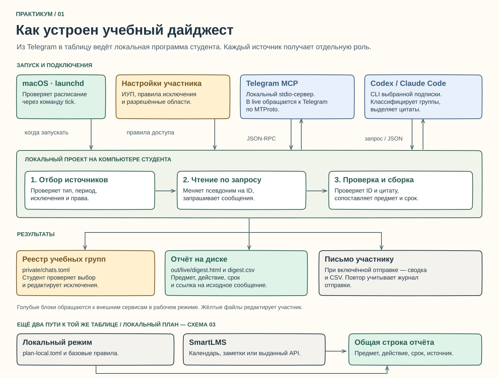
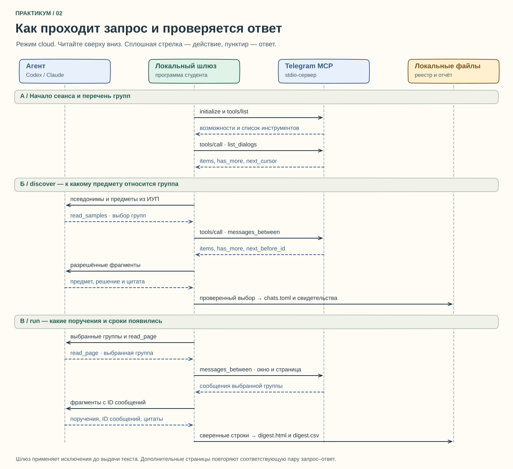

# Как группа в Telegram превращается в строку учебного дайджеста

[Вернуться к практикуму](../../README.md) · [Настройка на Mac](../macos.md)

## 1. Из каких частей собрана система



[Открыть схему крупно](topology.svg) · [Скачать редактируемую схему Excalidraw](topology.excalidraw)

За разными блоками стоит конкретное действие. Студент выписывает названия дисциплин в `private/study.toml`. Это словарь предметов, с которым сверяется каждое решение. Участник указывает правила исключения в `private/chats.toml`. В режиме облачной обработки уточняет, какие материалы конкретного чата, за какой период и какому провайдеру разрешено передавать. Эти сведения хранятся в отдельном `private/telegram-scopes.toml`. Файл фиксирует проверку человеком. Если нужных разрешений нет, выберите синтетический пример или локальный режим. [Условия Telegram для данных и ИИ](https://telegram.org/tos/content-licensing)

Шлюз — это обычный код на вашем Mac. Он запускает публичный Telegram MCP как отдельный процесс, проверяет список инструментов сервера и применяет ограничения перед чтением и перед отправкой данных выбранной модели. У сервера есть два режима. В `demo` он отвечает встроенными вымышленными данными. В `live` обращается к Telegram по MTProto с использованием локальной сессии студента. Подписка Codex или Claude не нужна самому MCP для чтения. [Код шлюза](../../telegram_stdio.py) · [Проверенная версия upstream MCP](https://github.com/daniil-novel/telegram-mcp/tree/3e87313b69fe6e228923ca19f25d76859eefbc13)

**Где проходит вход в Telegram.** В инструкции разработчика для macOS используются Git, uv и Python 3.11+. Команда авторизации выполняется лично студентом в Terminal. Она запрашивает номер, код Telegram и, при необходимости, пароль двухэтапной проверки. Набираемые символы скрыты. Вход создаёт локальную сессию. Если не задан другой путь, на macOS это `~/.local/share/telegram-readonly-mcp/session.secret`, где знак `~` означает домашнюю папку пользователя. В upstream на Mac используются права файла 0600 и папки 0700: доступ имеет владелец. Содержимое файла само по себе не зашифровано. Позже процесс `serve` использует эту сессию. Собственные API ID и hash, коды входа и содержимое файла сессии не нужны ни для рисунка, ни для отчёта о практике. [Порядок установки, входа и хранения сессии](https://github.com/daniil-novel/telegram-mcp/blob/3e87313b69fe6e228923ca19f25d76859eefbc13/README.ru.md)

**Граница локального режима.** Группы из `[local.chat_ids]` и `[local.chat_titles]` обрабатываются на ноутбуке. В облачном проходе такие группы удаляются из списка кандидатов до запроса истории. Для остальных групп в облачном режиме одного упоминания в `[tracked]` недостаточно. Шлюз сверяет исключения, срок и область разрешения, выбранного провайдера, отмеченное участником разрешение платформы и продолжающиеся согласия состава группы. Сокращения, псевдонимы и локальные правила не заменяют этих условий. [Отбор в программе](../../telegram_agent.py) · [Раздел об ИИ в условиях Telegram](https://telegram.org/tos/content-licensing)

| Поток | Вход → результат | Зачем это участнику |
| --- | --- | --- |
| Проверка соединения | `doctor` → рукопожатие и перечень инструментов только для чтения | Видно, что запущен подходящий сервер. Для такой проверки читать содержимое учебных чатов не требуется. |
| Инвентаризация | `inventory` → страницы каталога MCP → локальная выборка по времени → `private/dialogs.csv` | Можно выбрать группу или явно исключить её ID до облачной обработки. Предпросмотр из каталога MCP не включается в файл и не отправляется модели. |
| Поиск групп | `discover` в облачном режиме → разрешённые кандидаты → короткие примеры → выбор предмета или отказ → проверка цитаты → реестр | Можно открыть исходное сообщение и объяснить, почему группа отнесена к дисциплине. Новые соответствия попадают в `private/chats.toml`, подтверждающие строки — в `private/discovery-evidence.csv`. |
| Чтение выбранных групп | `run` → разрешённая история выбранного чата → проверенные поручения → HTML и CSV | В строке видны предмет, поручение, срок, источник и доступная ссылка на сообщение. |
| Только локальные правила | Выбранные студентом источники → локальная обработка → та же структура строк | Можно получить сводку без передачи текстов группы внешней модели. Словарные правила могут пропустить неявное поручение. |
| SmartLMS | Файл, подписка календаря, личные записи или отдельно выданный доступ к API → строки заданий | Событие пары и карточка со сроком сдачи имеют разное значение. Формирование отчёта объединяет поступившие записи с результатами Telegram. |
| Доставка | `send` или подходящий момент для `tick` → собственный адрес студента → письмо с таблицей и CSV | На Mac `launchd` периодически запускает `tick`; время рассылки задаётся в `[schedule]`. Таблица доступна на диске и при выключенной почте. [Код расписания](../../digest_schedule.py) |

**Что означает «последние N».** Сам MCP отдаёт доступные диалоги по возрастанию числового ID. Шлюз дочитывает доступный каталог постранично, берёт дату `latest.date`, сортирует записи по убыванию активности и только затем выбирает до `max_dialogs` строк. Лимит страницы — число записей в одном ответе сервера. Лимит N — число сохраняемых кандидатов после сортировки. Последние N среди доступных этому запуску групп и диалогов зависят от разрешений MCP. Для классификации отбираются только активные группы и каналы. Личное сообщение никогда не должно стать кандидатом в учебные группы. [Сортировка каталога в клиенте](../../telegram_stdio.py) · [Порядок исходных страниц в MCP](https://github.com/daniil-novel/telegram-mcp/blob/3e87313b69fe6e228923ca19f25d76859eefbc13/src/telegram_readonly_mcp/service.py)

## 2. Кто кому посылает запрос



[Открыть последовательность крупно](sequence.svg) · [Скачать редактируемую последовательность Excalidraw](sequence.excalidraw)

На диаграмме четыре участника. Дорожка «Агент» означает выбранную модель через локальную команду Codex или Claude. Дорожка «Локальный шлюз» показывает управляющую программу. Настоящий процесс MCP отвечает на запросы из третьей дорожки. Правая дорожка показывает запись на диск. На схеме два отдельных запуска — сначала можно найти группы через `discover`, позже собрать сводку через `run`. На рисунке опущено повторное открытие сеанса при новом запуске.

**Сеанс MCP.** Клиент открывает стандартные потоки запущенного процесса — stdin для запросов и stdout для ответов. В этих потоках SDK передаёт по одному сообщению JSON-RPC на строку. Связь начинается с запроса `initialize`, ответа о поддерживаемом протоколе и возможностях и уведомления `notifications/initialized`. Затем `tools/list` возвращает каталог методов. После проверки каталога шлюз может послать `tools/call`. Имя вызываемого инструмента и его аргументы описаны внутри такого сообщения. Таким образом, `stdio` обозначает способ передачи, JSON-RPC — устройство сообщения, MCP — правила обмена для типовых операций. [Жизненный цикл MCP](https://modelcontextprotocol.io/specification/2025-11-25/basic/lifecycle) · [Транспорт stdio](https://modelcontextprotocol.io/specification/2025-11-25/basic/transports) · [Вызов инструментов](https://modelcontextprotocol.io/specification/2025-11-25/server/tools)

**Два разных протокола.** На участке «модель → шлюз» строка `{"tool":"read_samples","groups":["g1"]}` — решение на языке нашего практикума. Оно просит образцы сообщений только для предложенного псевдонима. Модель получает также разрешённые заголовки для выбора, но не задаёт реальный номер чужого чата. Шлюз сопоставляет `g1` с локальным ID и сам формирует вызов MCP. Для второго прохода используется `read_page`. Ни `read_samples`, ни `read_page` не являются инструментами Telegram MCP. [Два прохода агента](../../telegram_agent.py)

### Один вызов построчно

Значения ниже вымышлены. Это сокращённый учебный пример содержимого запроса. SDK сам проставляет идентификатор запроса и отправляет компактную строку JSON. В терминал этот фрагмент вводить не нужно.

```json
{
  "jsonrpc": "2.0",
  "id": 17,
  "method": "tools/call",
  "params": {
    "name": "messages_between",
    "arguments": {
      "params": {
        "chat_id": -1001234567890,
        "start": "2026-10-01T00:00:00+03:00",
        "end": "2026-10-04T10:00:00+03:00",
        "before_id": 0,
        "limit": 3
      }
    }
  }
}
```

| Поле | Как его понимать |
| --- | --- |
| `id: 17` | Номер запроса JSON-RPC. По нему клиент находит ответ. У номера сообщения Telegram и номера чата отдельные поля. |
| `name` | Имя метода, которое знает upstream. Для каталога передаётся `list_dialogs`, для интервала сообщений — `messages_between`. |
| Два уровня `params` | Внешний блок — параметры стандартного `tools/call`. Внутренний — аргумент `params` Python-функции Telegram MCP. Между ними находится стандартное поле `arguments`. |
| `chat_id` | Проверенный числовой ID одной группы. Шлюз получает его из своего соответствия. |
| `start`, `end` | Начало интервала включено, конец исключён. В обеих отметках указано смещение часового пояса. Для облачного чтения берётся пересечение разрешённого периода с окном обработки именно этого запуска. |
| `before_id: 0` | Начать с самых новых сообщений периода. Для следующей страницы используется ответ сервера `next_before_id`. Само сообщение на границе следующей страницы повторно не возвращается. |
| `limit: 3` | Прочитать до трёх записей в этом запросе. Если данных меньше, результат может быть короче. |

Ниже для того же примера показан **фрагмент** `result.structuredContent`. В настоящем ответе MCP есть дополнительные поля.

```json
{
  "source": "telegram",
  "items": [
    {
      "chat_id": -1001234567890,
      "id": 84,
      "date": "2026-10-03T14:00:00+03:00",
      "text": "Сдать план до 09.10.2026."
    }
  ],
  "has_more": false,
  "next_before_id": null
}
```

У события каталога для перехода по страницам используется строка `next_cursor`. Она непрозрачна — передавайте полученное значение дальше без разбора. У истории той же группы курсор является номером сообщения `next_before_id`. Эти два поля нельзя менять местами. Если сервер утверждает, что данные ещё есть, но не даёт подходящего продолжения, программа останавливается. [Схемы ответов upstream](https://github.com/daniil-novel/telegram-mcp/blob/3e87313b69fe6e228923ca19f25d76859eefbc13/src/telegram_readonly_mcp/models.py)

### От ответа MCP до письма

1. После получения страницы код сверяет значение `source` с выбранным режимом, принадлежность записей чату, их диапазон дат и порядок идентификаторов. Для облачной обработки рабочего чата дополнительно сверяет отправителя с разрешённым составом. Поле `text_truncated` сигнализирует, что текст обрезан.
2. Шлюз оставляет в передаваемой модели записи только номер сообщения и разрешённый текст. В рабочем режиме локальный фильтр также отбрасывает фрагменты с признаками личных данных, например со ссылкой или адресом почты. Это может удалить часть полезного задания и не даёт гарантии обезличивания. Заголовок разрешённой группы передаётся отдельно с учётом фильтра. Ключ API Telegram, файл сессии, фактический ID чата и полный ответ MCP для этого шага модели не нужны.
3. На этапе поиска агент возвращает, например, `{"course":"Управление проектами","id":84,"quote":"Сдать план до 09.10.2026."}`. Предмет должен входить в список разрешённых дисциплин. При нехватке оснований модель может вернуть `{"course":null}`. Сохранённый ID и цитата позволяют студенту проверить выбор. Одна короткая цитата показывает основание решения, но не доказывает, что все сообщения этой группы относятся к предмету.
4. На этапе сбора ответ имеет вид `{"tasks":[{"id":84,"quote":"Сдать план до 09.10.2026."}]}`. Код проверяет, что цитата дословно входит в сообщение № 84, затем детерминированно извлекает срок. У «сдать к пятнице» формального числа нет — участник увидит пометку об уточнении.
5. На диске появляются итоговые HTML и CSV. Найденные номера сообщений и подписи источников сохраняются. Прямая ссылка зависит от типа группы и возможностей адаптера. Общее содержимое группы не прикладывается к письму.

### Что изменится, если изменить вход

| Изменение | Где оно проявится |
| --- | --- |
| Участник поместил ID в исключения | Группа исключается и из ручного, и из автоматического отбора. При изменении конфигурации во время защищённого прохода его следует запустить заново. |
| Преподаватель написал только «обсудим завтра» | Отсутствуют явное поручение и полный срок. Поручение не должно получать вымышленную дату. |
| В группе появился неподтверждённый отправитель | Облачный проход останавливается. Участник проверяет состав группы и область разрешения. |
| У группы закончилось разрешение на обработку | Шлюз повторяет проверку перед передачей фрагмента и перед принятием ответа. Группа с истекшей областью не должна попасть в облачный результат. |
| Обнаружено больше разрешённых сообщений, чем помещается в одну страницу | В сборе `run` повторяется чтение того же интервала с новым `before_id`. В поиске `discover` короткий образец намеренно ограничен. |
| На Mac выбран другой график | Меняется время запуска. Порядок чтения MCP, формат цитат и правила проверки сроков остаются теми же. |

## 3. Как изменить рисунок для защиты

1. Скачайте файл `.excalidraw` нужной схемы из этого каталога. На GitHub для отдельного файла доступна кнопка загрузки исходника. SVG открывается как готовая картинка.
2. Откройте редактор Excalidraw и перетащите в него файл `.excalidraw`. Надписи, карточки и стрелки останутся редактируемыми. Для работы с учебным примером достаточно двух схем из этого каталога. [Редактор Excalidraw](https://excalidraw.com/)
3. Например, замените в копии подпись «Codex / Claude Code» названием клиента, который проверила ваша пара. Проверьте, откуда идёт стрелка и кто формирует данные на обратной стороне.
4. Сохраните редактируемую сцену и экспортируйте её в SVG под тем же именем. Вставьте обновлённый SVG в методичку. Так одногруппники увидят рисунок на GitHub, а для последующих изменений останутся исходные объекты.
