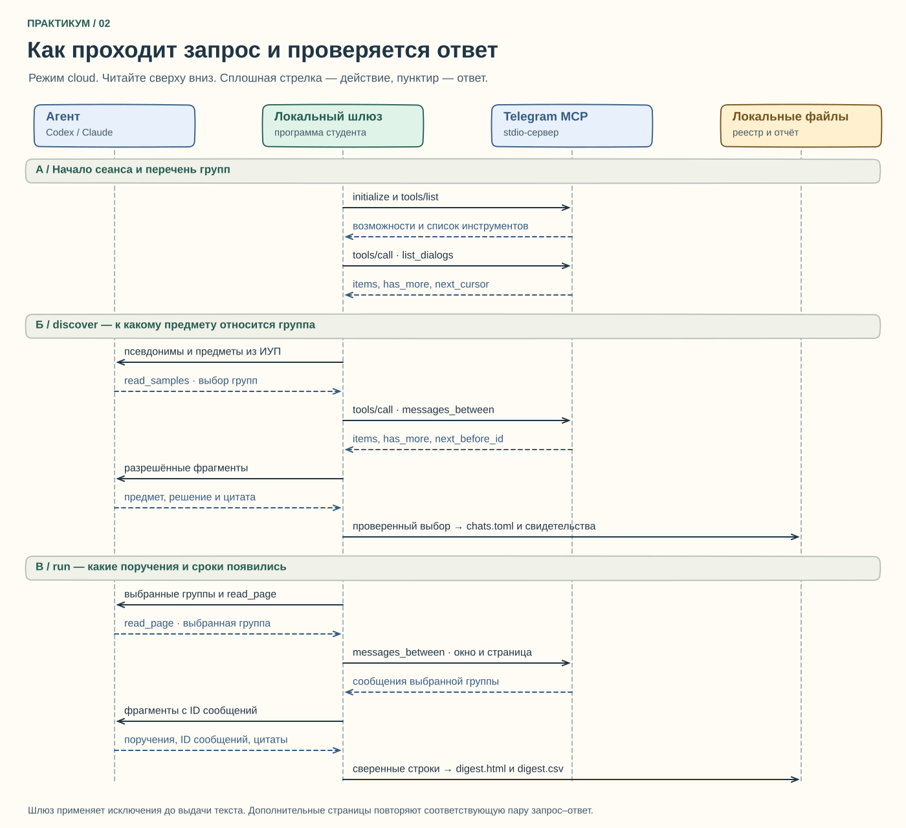

# Методичка. Как собрать учебный дайджест на Mac

После занятия вы сможете открыть одну таблицу и увидеть, по какому предмету нужно сдать работу, когда и где это было объявлено. Для каждого срока сохраните подтверждение. Если источники расходятся, человеку нужно увидеть обе версии.

**Маршрут семинара.** Шаги 1–5 показывают работу агента на вымышленных диалогах. На шаге 6 есть отдельный сценарий для реальной группы «Семинар наставника» с обработкой на вашем Mac. Доставка возможна и из другого разрешённого источника, например из своего конспекта задания в Smart LMS. На шагах 7–10 проверьте таблицу, выберите расписание и покажите результат. На первом самостоятельном проходе заложите 15–20 часов, ориентир 18. Базу можно пройти за 10–12 часов с коротким видео.

## 1. Приготовьте рабочую папку

1. Откройте в браузере репозиторий проекта, нажмите **Code → Download ZIP**. В Finder откройте «Загрузки» и дважды щёлкните архив. В появившейся папке видны `digest.py`, `README.md` и папка `templates`. Если их не видно, откройте вложенную папку. [Репозиторий практикума](https://github.com/daniil-novel/hse-study-digest)
2. В Finder выберите **Переход → Домой**. Создайте там папку `StudyDigest` и переместите в неё содержимое распакованного проекта. Откройте папку и проверьте, что `digest.py` лежит прямо в ней. Это постоянное место на вашем диске. Позже здесь появятся персональные сводки и настройки. Синхронизируемая папка группы для этих файлов не подходит.
3. Нажмите **⌘ + пробел**, наберите «Терминал», нажмите Return. Каждую строку из таблиц ниже вводите отдельно, затем нажимайте Return. Проценты, имя пользователя и символы приглашения уже показывает компьютер, перепечатывать их не нужно.

| Команда | Что делает и как понять результат |
|---|---|
| `cd ~/StudyDigest` | `cd` меняет текущую папку, `~` означает вашу домашнюю папку. Следующие команды работают с этой копией проекта |
| `pwd` | Показывает полный путь. Сохраните его для настройки сервера. Пример вида пути — `/Users/anna/StudyDigest` |
| `ls` | Показывает содержимое папки. Должны быть видны `digest.py` и `templates` |
| `python3 --version` | Просит Python показать версию. Нужна 3.11 или новее. Если команда не найдена или версия ниже, установите актуальный Python 3 для macOS с официального сайта. Снова откройте Терминал и повторите первые четыре команды. [Python для macOS](https://www.python.org/downloads/macos/) |

## 2. Установите программу и реальный Telegram MCP

MCP — способ, которым программа обращается к инструменту. В этом проекте локальная программа на Python запускает сервер Telegram отдельным процессом. Запрос и ответ проходят через стандартные потоки ввода и вывода процесса, такой режим называется **stdio**. Telegram-сервер слушает команды локального клиента. Публиковать сервер в интернете для практики не требуется.

| Команда | Зачем нужна | Что проверить |
|---|---|---|
| `python3 -m venv .venv` | `-m` запускает модуль Python, `venv` создаёт отдельное окружение, `.venv` — его папка. Здесь будут библиотеки только для практикума | Команда завершилась без ошибок. Finder обычно скрывает имена с начальной точкой |
| `source .venv/bin/activate` | `source` выполняет указанный файл в текущем Терминале. Команды `python` и `telegram-mcp` теперь ищутся внутри проекта | В начале строки обычно появляется `(.venv)`. В новом окне вернитесь в папку через `cd ~/StudyDigest` и повторите эту строку |
| `python -m pip install -r requirements-mcp.txt` | `python` означает Python из созданного окружения. Его установщик `pip` по команде `install` читает список из файла после `-r`. Список включает настоящий пакет Telegram MCP из указанного публичного выпуска | Терминал должен вернуться к приглашению без сообщения об ошибке |
| `which telegram-mcp` | `which` показывает, какой исполняемый файл запустится | Путь оканчивается на `StudyDigest/.venv/bin/telegram-mcp`. Скопируйте **свой** полный путь |
| `telegram-mcp --help` | `--help` показывает доступные команды установленного сервера | В списке должны быть `auth`, `protect-env` и `serve` |
| `python digest.py init` | Запускает основной файл практикума и создаёт ваши экземпляры настроек | Найдите папку `private` и откройте в ней `study.toml`. Закомментированные строки с TODO подсказывают, что заменить |

Для воспроизводимости практикум использует публичный выпуск **v0.2.2**. Секретов аккаунта он не содержит. Один и тот же сервер поддерживает учебный и реальный режим. В программе регистрируется только нужное соединение. Для этого маршрута **не добавляйте универсальный сервер Telegram в общий профиль Codex или Claude**. Иначе модель в обычном чате может получить набор инструментов с правами за пределами отбора практикума. [Выпуск Telegram MCP](https://github.com/daniil-novel/telegram-mcp/releases/tag/v0.2.2) · [Инструкция автора для macOS](https://github.com/daniil-novel/telegram-mcp/blob/v0.2.2/README.ru.md)

**Как редактировать файлы.** Введите `nano private/study.toml`. `nano` — встроенный текстовый редактор, второй аргумент — путь к настройкам. Перемещайтесь стрелками. Нажмите **Control + O**, затем Return, чтобы сохранить. Нажмите **Control + X**, чтобы выйти. В меню редактора знак `^` означает Control. Команды Терминала вводят уже после выхода из редактора. В TOML знак `#` начинает комментарий, квадратные скобки обозначают раздел, знак `=` связывает имя поля со значением. Числа и значения `true` и `false` пишутся без кавычек, текст — в кавычках.

Найдите раздел `[mcp]`. В существующем поле `executable` впишите путь, который показал `which telegram-mcp`, в кавычках. Для первых запусков выберите `demo = true`. Это подключает учебный набор поставщика. Настоящий Telegram при таком запуске не открывается. В файле должен остаться **один** раздел `[mcp]` и одно поле с каждым именем. [Исходный шаблон](../templates/study.toml)

## 3. Подготовьте одну подписку

CLI — приложение, с которым можно общаться из Терминала. Для практики нужен **один** CLI. Учебный MCP и подписка решают разные задачи. Первый предоставляет чтение, второй интерпретирует текст. Даже на вымышленных данных вызов модели расходует доступный лимит вашего аккаунта.

| Действие | ChatGPT и Codex | Claude и Claude Code |
|---|---|---|
| Установить клиент | Установите Node.js LTS с официальной страницы, снова откройте Терминал в папке проекта и активируйте окружение, затем введите `npm install -g @openai/codex`. Менеджер пакетов `npm` выполнит установку `install`, ключ `-g` сделает клиент доступным пользователю, `@openai/codex` — название пакета | Если на Mac установлен Homebrew, введите `brew install --cask claude-code`. `brew` — менеджер программ, `install` устанавливает выбранный пакет, `--cask` обозначает готовое приложение. Если Homebrew отсутствует, используйте вариант для macOS на официальной странице установки Claude Code |
| Проверить наличие | `codex --version` покажет номер Codex CLI | `claude --version` покажет номер Claude Code |
| Войти в отдельный профиль практикума | `python digest.py auth codex` откроет вход для адаптера практикума. Выберите вход **с ChatGPT** и завершите его в браузере | `python digest.py auth claude` откроет вход для адаптера. Выберите вход со своей подпиской **Claude.ai** |
| Выбрать для сборки | В `[agent]` поставьте `provider = "codex"` | В `[agent]` поставьте `provider = "claude"` |

`auth` — одноразовый вход. При истечении сессии повторите ту же команду из папки практикума. Доступность инструмента и лимиты зависят от учётной записи. Запуски `codex exec` и `claude -p` используют сохранённый вход, если он прошёл проверку. Персональный API-ключ в `study.toml` не нужен. [Node.js](https://nodejs.org/en/download) · [Установка Codex](https://developers.openai.com/codex/cli/) · [Вход через ChatGPT](https://developers.openai.com/codex/auth/) · [Режим Codex для сценариев](https://developers.openai.com/codex/noninteractive/) · [Установка Claude Code](https://code.claude.com/docs/en/setup) · [Как Claude учитывает вызовы по подписке](https://support.claude.com/en/articles/15036540-use-the-claude-agent-sdk-with-your-claude-plan)

## 4. Проверьте соединение на вымышленных данных

Для этого шага оставьте `[mcp]` с `enabled = true` и `demo = true`. В разделе `[agent]` укажите `mode = "cloud"`, чтобы именно выбранная модель анализировала вымышленные сообщения. По умолчанию в новом файле стоит локальный режим. В учебном режиме отдельные файлы и фиксированная дата позволяют повторить опыт независимо от дня занятия. Письма и системное расписание включают на живой ветке.

| Команда | Что делаем | Где увидеть результат |
|---|---|---|
| `python digest.py doctor` | `doctor` проверяет соединение с настроенным MCP. Ошибка в пути к серверу обнаружится до сбора переписки | В терминале должны быть перечислены поддерживаемые операции чтения |
| `python digest.py inventory` | Получаем каталог с локальной стороны соединения. Это удобная отдельная проверка доступа | В `private/dialogs-demo.csv` видны вымышленные диалоги. Личные сообщения не используются для учебного отбора |
| `python digest.py discover` | Просим подписочную модель выбрать кандидатов и обработать разрешённые примеры. Под капотом она выбирает, у какого разрешённого кандидата запросить фрагмент | В `private/chats-demo.toml` сохраняется список. В `private/discovery-evidence-demo.csv` остаётся материал для сверки результата |
| `python digest.py run` | Выполняем весь цикл, включая актуализацию выбора и извлечение поручений. Для модели доступны данные только тех чатов, которые остались разрешены | Откройте `out/mcp-demo/digest.html` и `out/mcp-demo/digest.csv` в Finder. HTML удобен для чтения, CSV — для проверки по колонкам |

**Что вы наблюдаете.** Учебный сервер работает с фиксированными сообщениями начала октября 2026 года. Каталог содержит три диалога. В проверенном запуске с настоящим Codex по подписке агент отобрал группу и канал, исключил личный диалог и сохранил две цитаты в подтверждение отбора. Строки «Демо: задача N» в этом упражнении считаются поручениями «Демонстрационного курса». Восемь записей с номерами сообщений дали **четыре итоговые строки, по два источника на каждую**. Точных сроков в сообщениях не было. Ожидайте эти четыре строки на чистой конфигурации и сверяйте результат своего CLI с примерами. Пустой вывод требует проверки выбора чатов, доступа CLI и правил. После явного исключения всех учебных чатов пустая таблица ожидаема.

Технически запросы устроены так. Сервер отдаёт страницы каталога в своём порядке, включая предварительный просмотр сообщения. Локальная программа убирает текст просмотра, упорядочивает разрешённые диалоги по свежести и ограничивает число кандидатов. Поэтому значение N в конфиге ограничивает итоговый набор кандидатов. Сервер может прочитать больше записей каталога для выбора последних N. Чтобы определённый чат был недоступен **уже серверу**, ограничьте список разрешённых ID в его собственном env-файле. [Диаграмма вызовов и места проверок](diagrams/README.md)

## 5. Настройте предметы и отбор



**Предметы.** В браузере откройте iStudy ВШЭ, выберите **Войти через ЕЛК → Студент**, авторизуйтесь и откройте электронную зачётную книжку. Выберите свой учебный год и сверьте дисциплины текущего модуля. Это элементы ИУП; полный утверждённый план, в том числе индивидуальные изменения, при необходимости выдаст учебный офис. Сокращения удобно взять из групп или персонального расписания в личном кабинете и HSE App X. В приложении можно подписаться на расписание занятий из личного календаря. Этот календарь помогает проверить предмет и время пары. Срок сдачи берите из карточки задания или подтверждённого объявления. [iStudy](https://istudy.hse.ru/) · [ИУП](https://www.hse.ru/studyspravka/plan/) · [Зачётная книжка](https://www.hse.ru/studyspravka/zachetbook) · [Личный кабинет](https://lk.hse.ru/) · [Памятка ВШЭ по расписанию](https://economics.hse.ru/support/timetable) · [HSE App X](https://play.google.com/store/apps/details?id=com.hse.app2&hl=ru)

В `private/study.toml` отредактируйте существующие разделы. Левая часть записи предмета — каноническое название для таблицы, квадратные скобки справа — варианты, по которым его можно узнать. Две строки в одном разделе читаются как два разных предмета. Слова «АД» иногда обозначают разные курсы, поэтому убедитесь, что сокращение узнаваемо в контексте именно вашей программы.

```toml
[courses]
"Анализ данных" = ["АД", "data analysis"]
"Управление проектами" = ["управление проектами"]

[scan]
max_dialogs = 350   # TODO: выберите предел, например 300 или 400
page_size = 50      # сколько строк MCP возвращает за один запрос списка
sample_size = 3     # сколько разрешённых сообщений можно прочитать для оценки чата
```

Предел 350 и «два месяца» отвечают на разные вопросы. Сначала отбираются наиболее недавние доступные диалоги в пределах N. Затем для источников действуют проверки активности, типа группы и разрешённого интервала. У личной переписки, диалога за пределами доступного каталога или старой группы нет основания попасть в дайджест. Активность проверяется по двум **календарным** месяцам. Например, при запуске 4 ноября граница приходится на 4 сентября. Для пробного увеличения поменяйте только `max_dialogs`, сохраните файл и повторите `inventory`. При маленькой выборке сервер может вернуть меньше указанного предела.

**Список чатов.** Откройте `private/chats.toml` в живом режиме или `private/chats-demo.toml` в учебном. Назначение разделов одинаково. Фрагмент ниже показывает синтаксис на условном ID. Редактируйте существующие строки в своей копии, не вставляйте вторую секцию с тем же заголовком.

```toml
[tracked]
"-1001234567890" = "Анализ данных"  # учитывать этот чат для указанного курса

[exclude]
ids = ["-1009876543210"]             # пропустить конкретный ID при любом названии
title_regex = ['(?i)архив', '(?i)выпуск\s+2024']  # пропустить подходящие названия
```

- В `[tracked]` находятся выбранные предметные чаты. Автоматический проход добавляет найденные соответствия на диск. Чтобы вручную уточнить предмет, замените значение справа, сохранив номер группы слева.
- В `[exclude].ids` впишите ID с минусом и в кавычках. Это явный запрет внутри дайджеста, он имеет приоритет перед включением. Чтобы закрыть группе и доступ upstream-сервера, удалите её из `TELEGRAM_ALLOWED_CHAT_IDS` либо добавьте в `TELEGRAM_DENIED_CHAT_IDS`. Подробности в шаге 6.
- `title_regex` задаёт шаблоны для **названия** чата. Префикс `(?i)` снимает различие между прописными и строчными буквами. В выражении `выпуск\s+2024` сочетание `\s+` допускает один пробел или несколько. Одинарные кавычки TOML сохраняют обратную косую черту. Начните с одного узнаваемого слова. Точка в regex означает любой символ; слишком общий шаблон может скрыть нужную группу.
- Для слов внутри сообщений есть отдельный словарь `[local.task_regex]` в `private/study.toml`. Например, строка `"Подготовить презентацию" = ['(?i)принесите\s+слайды']` распознаёт просьбу «принесите слайды». В таблицу попадёт нейтральное название задания. Ключ берите из списка `OBJECTS` в `local_digest.py`. Проверьте своё правило на двух вымышленных фразах, одна из которых должна быть пропущена.
- Когда удаляете автоматически найденную запись из `[tracked]`, служебный список `[history].seen` помнит её прошлое включение. Чтобы сознательно разрешить автоматический возврат, удалите ID из `seen`, проверьте `exclude.ids` и подходящие исключения по названию, затем повторите `discover`. Доступность чата и действующие разрешения по-прежнему проверяются.

**Упражнение на вымышленных группах.** Прочитайте каталог после `inventory`. Найдите в нём ID группы и название. Сохраните копию учебной таблицы для сравнения. Добавьте ID этой группы в `exclude.ids` в учебном реестре, повторите `discover` и `run` и проверьте, что строки не ссылаются на исключённый чат. Удалите учебный ID из явного запрета и повторите опыт с `title_regex`, используя слово из названия. Объясните различие: запрет по номеру сохранится после переименования группы, а шаблон по названию может перестать совпадать.

## 6. Подключите реальный Telegram только в разрешённой области

**Выберите маршрут до входа.** Для обычной учебной группы оставьте `mode = "local"`: Telegram передаёт данные на ваш Mac, дальнейший разбор выполняет Python без обращения к провайдеру модели. Путь через `mode = "cloud"` доступен отдельно. Возможность прочитать группу своим Telegram-аккаунтом ещё не разрешает отправить её сообщения провайдеру. Условия Telegram ограничивают применение материалов платформы для ИИ и описывают исключения для конкретного содержимого и контекста при индивидуальном, явном, информированном и продолжающемся согласии всех затронутых пользователей. Для живого **облачного** сценария предусмотрена запись основания предоставленного исключения Telegram, личных согласий полного состава, разрешённого провайдера, времени переписки и срока действия. Запись в TOML сама не создаёт такого основания. [Условия использования контента Telegram](https://telegram.org/tos/content-licensing) · [Telegram API Terms, § 1.5](https://core.telegram.org/api/terms)

**Получение параметров Telegram.** Откройте `my.telegram.org` из официальной инструкции, войдите с вашим номером и откройте **API development tools**. Если приложение уже создано, возьмите его параметры; иначе заполните **App title**, **Short name** и другие обязательные поля по подсказкам формы. Например, можно назвать приложение «StudyDigest». На экране появятся `api_id` (число) и `api_hash` (секретная строка). Это регистрация вашего локального Telegram-клиента. Код подтверждения и пароль двухэтапной проверки вводятся непосредственно на официальном сайте или в локальном терминале при входе. [Кабинет Telegram](https://my.telegram.org/) · [Официальная процедура](https://core.telegram.org/api/obtaining_api_id)

**Файл подключения.** Из папки `StudyDigest` введите `nano private/telegram.env`. Если файл пуст, создайте такие строки. Угловые скобки в примере обозначают место для **вашего** значения, в готовом файле их не оставляйте. Путь к каталогу сессии зависит от результата `pwd`.

```dotenv
TELEGRAM_API_ID=<число с сайта Telegram>
TELEGRAM_API_HASH=<секрет с сайта Telegram>
TELEGRAM_SESSION_DIR=/Users/anna/StudyDigest/private/telegram-session
TELEGRAM_ALLOWED_CHAT_IDS=-1001234567890
TELEGRAM_DENIED_CHAT_IDS=
TELEGRAM_WRITE_ENABLED=false
TELEGRAM_WRITE_ALLOWED_CHAT_IDS=
```

- Пару `API_ID` и `API_HASH` читает непосредственно сервер Telegram. Обе настройки называются целиком так, как в блоке. Не снимайте этот экран для отчёта.
- В `SESSION_DIR` укажите полный путь внутри своей папки `private`. В macOS upstream хранит сессию в закрытой для других пользователей папке. Файл содержит данные авторизованного устройства; права файловой системы не шифруют его содержимое. Сеанс можно отозвать через **Telegram → Настройки → Устройства**.
- В `ALLOWED_CHAT_IDS` укажите конкретный разрешённый ID или несколько через запятую. Если ID ещё неизвестен, для супергруппы его можно восстановить из ссылки на сообщение вида `https://t.me/c/1234567890/17`: ID чата будет `-1001234567890`, а 17 — номер сообщения, он в ID не входит. В иных типах групп структура ссылки другая. Для служебного начального каталога используйте разрешённый upstream список, согласованный с владельцами, либо получите ID у владельца группы. Пустой разрешающий список закрывает все чаты. Звёздочка `*` открывает серверу весь доступный каталог и расширяет область наблюдения.
- В `DENIED_CHAT_IDS` можно добавить ID, которые upstream не должен выдавать даже локальному клиенту. Параметры `WRITE` оставляют отправку и изменение сообщений выключенными. Практикуму достаточно чтения. Поле `mcp.env_file` в `private/study.toml` должно ссылаться на этот файл по имени `telegram.env`.

**Защитите файл и войдите.** Команды ниже запускаются в активном окружении из шага 2.

| Команда | Что происходит |
|---|---|
| `telegram-mcp --env-file private/telegram.env protect-env` | `--env-file` задаёт файл настроек, `protect-env` ограничивает доступ к нему вашим пользователем macOS |
| `python digest.py telegram-login` | `telegram-login` запускает команду `auth` самого публичного Telegram MCP с путём к программе и env-файлу из вашего TOML. Для этого входа выберите `enabled = true` и `demo = false`. Введите номер с кодом страны, полученный код и при запросе пароль двухэтапной проверки. При скрытом вводе символы и звёздочки на экране могут отсутствовать |
| `python digest.py doctor` | После переключения на `demo = false` эта проверка показывает, какие инструменты предоставляет реальный сервер. Право читать конкретный чат проверьте отдельно |

### Локальный разбор «Семинара наставника»

**Как задействовать подписку, сохранив настоящую переписку на Mac.** После входа с `python digest.py auth codex` или `python digest.py auth claude` выберите тот же `provider` в `[agent]` и оставьте `mode = "local"`. Выполните `python digest.py plan-local`. Команда `plan-local` обращается к подписочной модели с фиксированным учебным словарём и встроенными **вымышленными** примерами. Модель предлагает правила, программа проверяет их и записывает в `private/plan-local.toml`. Откройте этот файл через `nano private/plan-local.toml` и посмотрите, какие признаки предлагается искать. Реальные названия чатов, курсы из вашего плана, сообщения и полученный отчёт в этот запрос не входят. При последующем `local`, `run` или запуске по расписанию в локальном режиме проверенные правила применяет сам ноутбук. Без этого необязательного шага остаются базовые локальные правила.

Верните `mode = "local"` в `[agent]`. В `[mcp]` укажите `enabled = true` и `demo = false`. Внесите учебный предмет «Семинар наставника» в `[courses]` как `"Семинар наставника" = []`. Найдите раздел `[local.chat_titles]`. Слева напишите **точное** название группы из Telegram, справа — название предмета из `[courses]`, без фамилий. Ниже пример для группы с обозначением учебного года. Если название на вашем устройстве отличается, замените левую часть.

```toml
[local.chat_titles]
"Семинар наставника 25/26" = "Семинар наставника"
```

Для известного ID можно использовать раздел `[local.chat_ids]`, вписав соответствие вида `"-1001234567890" = "Семинар наставника"`. Две разные группы могут относиться к одному предмету. Для проверки строго одной группы установите `auto_match = false` непосредственно в разделе `[local]`, перед заголовком `[local.chat_titles]`. Тогда одно совпадение по предмету не приводит к автоматическому включению соседней группы. Проверьте существующие ручные записи в `[tracked]`, а в `telegram.env` разрешите только ID нужной группы. Оставьте `[mail].enabled = false` на время проверки. Выполните `python digest.py discover` для локального отбора и сверяйте ID в `private/chats.toml`. Для более широкого поиска `auto_match = true` допускает присоединение чата, когда его заголовку соответствует только один предмет или псевдоним.

Введите `python digest.py local`. Команда выполняет локальный проход через настоящий MCP. Откройте локальный отчёт и сравните одно поручение с оригиналом в Telegram. Программа использует обобщённое описание действия, срок и ссылку на источник. Текст переписки и фамилии в облачную модель не передаются. Если встретилось «до следующей встречи», укажите в отчёте по практике, что дату пришлось уточнить. Полный сбор по основным настройкам запускается через `python digest.py run`. Письмо на личный адрес включается отдельно после просмотра. **Если условие практики — вообще ничего не выводить за пределы ноутбука, оставьте почту отключённой** и показывайте локальную таблицу.

### Облачный разбор живого чата при документированном разрешении

Для такого эксперимента откройте `private/study.toml`, выберите в `[agent]` `mode = "cloud"` и сверяйте провайдера с документами. Укажите в разделе `[consent]` имя файла `telegram-scopes.toml`. Откройте его через `nano private/telegram-scopes.toml`. Ниже показана **форма записи**, все номера условны. Для рабочих данных вносите только ссылки на проверенные локальные подтверждения; оригиналы согласий и персональные реквизиты не публикуются. Используйте собственные актуальные границы, явный часовой пояс и реального поставщика. Если разрешение отсутствует, оставьте файл пустым либо с комментариями и вернитесь к локальному маршруту.

```toml
[scope."-1001234567890"]
provider = "codex"       # тот провайдер, который указан в согласии и в [agent]
status = "revoked"       # заменить на "active" только после проверки оснований
start = "2026-11-01T00:00:00+03:00"       # начало разрешённого контента
end = "2026-12-01T00:00:00+03:00"         # конец разрешённого контента
valid_until = "2026-11-15T00:00:00+03:00" # дата прекращения действия разрешения
content = "title_and_messages"
platform_permit = "TODO: проверенная ссылка или номер исключения для этой области"
complete_roster = false  # заменить на true после проверки полного состава и прав
members = { "123" = "TODO: ссылка на согласие 1", "456" = "TODO: ссылка на согласие 2" }
```

Сверьте зафиксированный состав с актуальными участниками и правами на пересылаемые материалы. При отзыве согласия, изменении состава, смене провайдера или неясном авторстве остановите обработку, переведите статус в неактивное значение и уберите чат из разрешённого списка upstream. Фильтр проверяет внесённую конфигурацию и период. Правдивость сведений о согласиях, включая основание исключения и полноту списка, проверяет ответственный человек. Проверьте и сохранённый результат — удаление чата из области будущего доступа само по себе не удаляет прежние письма.

**Проверка живой ветки.** Установите `demo = false`, выполните `python digest.py inventory` и проверьте `private/dialogs.csv`. При `python digest.py discover` модель получает псевдонимы разрешённых кандидатов. Она может запросить образец через программный шлюз. Тот повторно проверяет доступ и вызывает разрешённую операцию MCP. Результат сохраняется в `private/chats.toml`. Теперь проверьте реестр **до** запуска `python digest.py run`. Для каждого выбранного чата должны сходиться предмет, ID и ваше право использовать его материалы. Удалите заведомо лишнюю строку и повторите `discover`, чтобы убедиться, что ручное удаление сохранилось.

## 7. Подключите задания Smart LMS и проверьте готовую таблицу

Откройте Smart LMS и карточку задания своего курса. Найдите **окончание приёма работ**, обратите внимание на часовой пояс. Дата открытия, дата пары и крайнее время сдачи могут различаться. [Smart LMS](https://edu.hse.ru/) · [Памятка ВШЭ](https://www.hse.ru/studyspravka/lms)

**Собственная заметка — доступный всем маршрут.** В `[lms]` поставьте `use_notes = true`. В `private/lms.json` запишите один объект по образцу ниже. JSON использует двойные кавычки для текста, запятые между полями и квадратные скобки для списка. Чтобы добавить вторую запись, поставьте запятую после закрывающей фигурной скобки первой и впишите вторую в тот же список. В примере нет сведений о реальных студентах.

```json
[
  {
    "id": "my-lab-1",
    "course": "Анализ данных",
    "text": "Сдать отчёт по лабораторной до 2026-11-15 18:00.",
    "url": ""
  }
]
```

`id` — постоянная метка одной записи. `course` должен точно совпасть с ключом в `[courses]`. `text` — информация, которую вы сформулировали самостоятельно и вправе обрабатывать. В `url` впишите обычную ссылку на карточку задания, когда она есть. Пустая строка подходит для пробного запуска. Ссылка на экспорт календаря может содержать пароль доступа, её сюда вставлять нельзя. Для сборки на одних заметках укажите `[mcp].enabled = false`, `[mcp].demo = false` и `[agent].mode = "local"`. При таких настройках `python digest.py run` читает личный файл с этого компьютера. В локальном режиме можно провести приёмку и почтовую проверку без Telegram и без подписки.

**Календарь.** Когда в интерфейсе Smart LMS есть **Календарь → Экспорт календаря**, выберите события курсов и период. В Moodle доступен файл `.ics` либо персональный адрес подписки. В первом случае данные обновляются после ручной замены файла, во втором — при очередном запросе программы. Доступ ко второму варианту зависит от настройки сайта. Укажите путь или разрешённый адрес `https://edu.hse.ru/calendar/export_execute.php?…` в поле `calendar` раздела `[lms]`. Убедитесь, что в категории, заголовке или описании встречается название предмета либо его псевдоним. Подтвердите хотя бы один срок по карточке в браузере. [Как Moodle экспортирует календарь](https://docs.moodle.org/en/Using_Calendar)

Для воспроизводимой проверки впишите в `[courses]` строку `"Алгоритмы" = []`, а в `[lms]` — `calendar = "examples/deadlines.ics"`. При необходимости выполните `python -m pip install -r requirements-calendar.txt`. Команда использует тот же установщик из виртуального окружения, только берёт список календарных библиотек. Выполните `python digest.py run`. По «Алгоритмам» ожидается «Срок сдачи отчёта по практике» **9 ноября 2026 в 20:59 МСК**. В файле есть и лекция: её время не попадает в колонку срока. После проверки верните `calendar = ""`, прежде чем подключать настоящие данные.

**REST API.** Для обладателя токена, выданного ВШЭ с соответствующим правом, есть отдельный вариант. Укажите ID курса в разделе `[lms.api_courses]`, например `"12345" = "Анализ данных"`. Номер возьмите из адреса самого курса. Переменная `HSE_LMS_TOKEN` служит секретом доступа. Если вам не выдавали токен или сервер отказал в доступе к методу календаря, пользуйтесь заметкой или календарным экспортом. У ВШЭ не подтверждена универсальная выдача REST-токена каждому студенту. [Модуль запросов и допустимые ответы](../lms_api.py)

**Что сверить в файлах.** В Finder откройте `out/live/digest.html` и `out/live/digest.csv`. Рабочий HTML показывает предмет, действие, срок в МСК, статус и источник. В CSV ссылка вынесена в отдельную колонку, разделитель — точка с запятой, кодировка UTF-8. В Numbers или Excel при необходимости выберите этот разделитель при импорте.

| Случай | Как принимать работу |
|---|---|
| В тексте «до 15.11.2026 18:00» | Сверьте в таблице день и время с открытым источником. Время из свободного текста читается в МСК; для другого пояса пересчитайте и уточните запись |
| Указан только день | День остаётся без выдуманных часов и минут |
| Написано «к следующей встрече» | В таблице требуется уточнить срок. Возможное время не объявляют дедлайном |
| Приходят разные сроки одного и того же поручения | Одинаковая нормализованная формулировка с разными датами помечается для сверки. При перефразировании возможны отдельные строки. Откройте обе ссылки |
| Сообщение старое, личное, служебное или в запретном чате | Строка из него в рабочей таблице не появляется |
| Нужная информация только на приложенном скане, в аудио или в закрытом недоступном курсе | Запишите ограничение покрытия. Внесите собственную проверенную заметку, если это допустимо |

## 8. Пришлите себе таблицу

Включайте этот шаг после просмотра локального отчёта. Письмо содержит таблицу и приложение CSV. Получатель — владелец почтового ящика. Для тренировки используйте отдельную синтетическую **личную заметку** по шагу 7, рабочий режим `demo = false` и отключённый `[mcp]`. Тогда проверяется реальная доставка учебных данных без передачи переписки. Если вы изучаете материалы, которые должны оставаться только на Mac, эту ветку с ними не включайте.

1. Подготовьте свой почтовый ящик с отправкой через SMTP поверх TLS, порт 465. Для Gmail включите двухэтапную проверку и в разделе безопасности создайте **пароль приложения**, если эта функция доступна вашему аккаунту. У некоторых учебных и корпоративных аккаунтов она отключена администратором. Для этой операции подходит отдельный пароль приложения. [Google о паролях приложений](https://support.google.com/accounts/answer/185833?hl=en) · [Параметры SMTP Gmail](https://knowledge.workspace.google.com/admin/gmail/send-email-from-a-printer-scanner-or-app)
2. В `private/study.toml`, раздел `[mail]`, установите `enabled = true`, впишите свой полный адрес в `address` и сервер в `host` (для Gmail — `smtp.gmail.com`). В конфиге нет поля для пароля.
3. Откройте через Spotlight приложение **Связка ключей / Keychain Access**. Выберите связку «Вход» (login), затем **Файл → Новый объект пароля / New Password Item**. Если в вашей версии приложение открывается через поиск с выбором приложения «Пароли», выберите именно Keychain Access. В поле имени объекта впишите ровно `hse-study-digest.smtp`, в поле учётной записи — **тот же адрес**, что в `[mail].address`, в поле пароля — выданный приложению пароль. Сохраните. Выбирайте собственную локальную связку. macOS может запросить разрешение на чтение записи при первом использовании.
4. Введите `python digest.py send`. `send` означает ручную отправку текущей сводки самому себе. Если всё сработало, откройте полученное письмо, затем откройте приложенный CSV и сравните одну строку с `out/live/digest.csv`. Текст «сервер принял письмо» подтверждает передачу почтовому серверу; получение подтверждают «Входящие». Проверьте «Спам» и «Отправленные», если письмо не видно.
5. Для будущих запусков в фоне пароль должен быть доступен тому же пользователю macOS. В качестве альтернативы поддерживается пользовательская переменная окружения `DIGEST_SMTP_PASSWORD`; временное значение в открытом Терминале само по себе не передаётся задаче launchd. Связка ключей удобна и для ручной отправки, и для расписания. Пароля в командной строке, на скриншотах и в репозитории быть не должно.

## 9. Настройте расписание в TOML

Решите, когда вам полезно получить выпуск. Для примера ниже — **вторник и четверг в 09:00 по Москве**. Текущее время и часовой пояс компьютера могут отличаться от пояса доставки. В `private/study.toml` измените существующий раздел.

```toml
[schedule]
mode = "weekly"                 # разрешены daily, weekly и monthly
weekdays = ["tue", "thu"]       # понедельник mon, вторник tue и т. д.
month_days = [1, 15, -1]        # при monthly это 1-е, 15-е и последний день
times = ["09:00"]               # часы и минуты, всегда в 24-часовом формате
timezone = "Europe/Moscow"      # часовой пояс выпуска
catchup_hours = 24              # окно для последнего пропущенного выпуска
date_regex = ""                 # дополнительное ограничение по дате, пока выключено
```

| Что вам нужно | Какие поля поменять в существующем разделе |
|---|---|
| Каждый день в 18:30 | `mode = "daily"`, `times = ["18:30"]` |
| Понедельник и четверг в 09:00 | `mode = "weekly"`, `weekdays = ["mon", "thu"]`, `times = ["09:00"]` |
| Один раз в месяц, в последний день | `mode = "monthly"`, `month_days = [-1]` |
| Два раза в месяц | `mode = "monthly"`, `month_days = [1, 15]` |
| N раз в месяц, например три | `mode = "monthly"`, `month_days = [1, 12, 24]`. Вы задаёте N фактических чисел месяца. Для равномерного интервала учтите, что длина месяцев различается |
| Дважды в каждый выбранный день | `times = ["09:00", "18:30"]`. Этот список действует для любого режима |
| Временно только в ноябре 2026 | `date_regex = '^2026-11-'` поверх вашего режима. Выражение применяется к строке вида `2026-11-04`, знак `^` означает начало строки |

Дни недели обозначаются как `mon, tue, wed, thu, fri, sat, sun` от понедельника до воскресенья. Число 31 отсутствует в некоторых месяцах, поэтому для «последнего дня» выбирайте `-1`. Поля неиспользуемых режимов можно оставить как в шаблоне. После каждой правки введите `python digest.py schedule`: команда рассчитывает ближайшие запуски, ничего не отправляя. Сопоставьте первую напечатанную дату с обычным календарём. Если ни одна дата не подходит, уберите временное ограничение и проверьте снова.

## 10. Дайте macOS запускать задачу

**launchd** — встроенная служба macOS. Здесь она раз в минуту запускает короткую проверку, пока вы вошли в свой пользовательский сеанс. Почта уходит по расписанию из TOML. Компьютер должен быть включён и иметь доступ к нужным источникам, почте и связке ключей. После сна окно `catchup_hours` разрешает догнать самый свежий пропущенный выпуск. Его увеличение не заставляет отправлять всю накопленную очередь. [Apple о пользовательских заданиях launchd](https://developer.apple.com/library/archive/documentation/MacOSX/Conceptual/BPSystemStartup/Chapters/CreatingLaunchdJobs.html)

1. Выполните `python digest.py schedule` и проверьте ближайшую дату, час и часовой пояс. Если возможна передача реальных закрытых материалов, для проверки расписания вернитесь к заведомо учебной личной заметке из шага 7.
2. Убедитесь, что `demo = false`, настройки почты проверены предыдущим шагом и папка проекта останется на месте. Выполните `python digest.py install-schedule`. Команда сохранит параметры пользовательского задания в `~/Library/LaunchAgents/local.hse-study-digest.plist` и зарегистрирует его через macOS. Компьютер запоминает абсолютные пути к Python и вашему проекту. Поэтому перед переносом папки снимите старое расписание.
3. Для проверки без ожидания нескольких дней укажите в TOML следующий удобный час и минуту в пределах сегодняшнего дня и выберите `daily`. Проверьте ожидаемый момент командой `schedule`, оставьте Mac включённым, дождитесь письма и верните итоговое расписание. Посмотрите журналы `private/schedule.log` и `private/schedule-errors.log`. При первом запуске учитывайте окно догоняющей доставки: недавний просроченный выпуск тоже может стать допустимым.
4. Введите `python digest.py tick`, если нужно проверить поведение планировщика вручную. Команда вычисляет последний наступивший момент внутри окна и проверяет состояние его доставки. При выключенной почте, учебном режиме или отсутствии подходящего момента она завершится без отправки. Такой запуск может действительно отправить письмо, если момент уже наступил.
5. Для проверки защиты от дублей повторите `tick` для того же наступившего момента и адреса. Сравните папку почты и журнал; второй экземпляр **планового выпуска** не должен уйти. Если сервер потерял соединение во время отправки, сначала проверьте «Отправленные» и «Входящие». Удалять файл журнала отправок для повтора рискованно.
6. Чтобы остановить расписание, выполните `python digest.py remove-schedule`. Команда снимет пользовательское задание. Можно дополнительно поставить `[mail].enabled = false`. После переноса папки или пересоздания виртуального окружения зарегистрируйте задачу заново из новой папки.

## 11. Постройте и проверьте своё правило

Этот опыт занимает 20–40 минут из блока самостоятельной работы. Вы напишете небольшой входной пример, поменяете одно правило в локальном модуле и сравните таблицу решений до и после. Реальная переписка, вход в аккаунт и почта не нужны.

1. Распакуйте вторую копию проекта, чтобы сохранить исходное поведение основного экземпляра. Откройте Терминал в новой папке. Используйте ранее созданное Python-окружение, набрав `source ~/StudyDigest/.venv/bin/activate`. Ярлык интерпретатора берётся из этого окружения, а файловые модули ниже — из текущей папки.
2. Введите `nano practice_rule.py`. Создайте небольшой файл с таким содержимым. Знак `#` начинает комментарий для читателя, Python его пропускает.

```python
from datetime import datetime                  # Текущее время для вызова обработчика
from local_digest import tasks_from_message    # Проверяет только одну учебную запись
from study_sources import MOSCOW               # Тот же пояс, что в сводке

message = {"text": "Подготовить конспект главы до 2026-11-20."}
now = datetime.now(MOSCOW)                     # Отметка запуска с часовым поясом
tasks = tasks_from_message(message, now)        # Пары «нейтральное действие, срок»
print(tasks)                                   # Показывает результат в терминале
```

3. Сохраните через Control + O, Return и выйдите через Control + X. Введите `python practice_rule.py`. Переменная `message` содержит единственное вымышленное сообщение. На исходной версии ожидается `[]` — пустой список. Слово «подготовить» распознаётся как действие, но «конспект» ещё отсутствует среди объектов.
4. Введите `nano local_digest.py`. Найдите список `OBJECTS` в начале файла. Перед его последней закрывающей квадратной скобкой добавьте строку ниже. Внутри круглых скобок слева стоит выражение для поиска в исходном тексте, справа — фиксированное название для отчёта. Завершающая запятая разделяет элементы.

```python
    (r"конспект", "Подготовить конспект"),
```

5. Сохраните файл и повторите `python practice_rule.py`. Ожидается `[('Подготовить конспект', '2026-11-20')]`. Теперь в учебной фразе замените «до 2026-11-20» на «к следующей встрече» и запустите снова. Ожидается то же действие с пустым значением срока. В итоговой таблице это причина обратиться к источнику.
6. Что ещё изменилось из-за этого правила? Протестируйте фразу «Нужно подготовить конспект для себя». Попросите напарника решить, является ли она обязательным поручением преподавателя. Предложите дополнительный признак и два примера, которые позволят увидеть ошибочный пропуск и ложное срабатывание.

Пройдите штатные тесты командой `python -m unittest discover -s tests`. Флаги `-m unittest` запускают встроенный модуль тестов Python. Подкоманда `discover` ищет проверки, `-s tests` указывает каталог поиска. Итог `OK` означает, что выполненные проверки прошли. Пометка `skipped` у календарной проверки означает, что в этом окружении не установлено необязательное дополнение. Реальную доставку письма и работу launchd подтверждают отдельно. [Что делает каждый модуль](README.md)

## Приёмка работы и короткая демонстрация

Выберите для видео только учебный набор, свой тестовый почтовый ящик или уже обезличенные результаты. Подходящий сюжет на 3–5 минут: объяснить схему, показать отбор, исключить одну вымышленную группу, сравнить таблицу до и после, показать предстоящие даты рассылки. Для живой группы в отчёте достаточно общего названия, количества проверенных строк и результата сверки. Файлы `private`, авторизационные экраны, реестр согласий, адрес подписки календаря и рабочую переписку на экран записи выводить не требуется.

**Предлагаемая шкала для экспертов семинара — 10 баллов.** Каждую из пяти строк можно оценить в 2 балла за воспроизводимый результат и объяснение, 1 — только за одну из этих частей, 0 — если обе части отсутствуют.

| Что проверяют | Что участник предъявляет |
|---|---|
| Источники и MCP | Два названия из ИУП, успешную проверку соединения и объяснение, что именно видит MCP |
| Два режима работы | На вымышленном примере показывает, какие запросы предлагает модель. На локальном объясняет, откуда берётся нейтральное поручение без передачи сообщений ИИ |
| Постоянный реестр и правила | Результат повторной сборки после ручного удаления, запрета по ID или regex. Объяснение границы N и двух месяцев |
| Качество результата | Сверенную строку с источником, один спорный или неизвестный срок и собственный опыт с изменением кода |
| Расписание и письмо | Подтверждённый выпуск с CSV в своём ящике, ближайшие даты и отсутствие дубля одного планового выпуска |

Пишите в отчёте, какую проверку вы действительно провели. Например, «проверены даты и установка расписания; письмо ещё не получено» и «получено тестовое письмо, вложение совпало» — два разных результата. Для закрытой работы можно документировать только локальную проверку, а доставку показать отдельно на собственной учебной записи.

## Если что-то не работает

| Наблюдение | Как проверить причину |
|---|---|
| Не находится `digest.py` | Выполните `pwd` и `ls`; в текущей папке должен быть именно файл `digest.py`. Вернитесь в `~/StudyDigest` |
| Не находится модуль или `telegram-mcp` | Закройте лишние окна, откройте нужную папку, снова выполните `source .venv/bin/activate`, затем `which telegram-mcp`. Проверьте путь в TOML |
| Python жалуется на TOML | Проверьте повторяющиеся названия секций, кавычки, скобки, запятые. В `[local.chat_titles]` и `[tracked]` каждая строка сопоставляет чат с существующим предметом |
| `doctor` завершился успешно, но группа не читается | Он проверяет доступные методы. Проверьте авторизацию upstream, его разрешённые и запрещённые ID, последнюю активность, локальный реестр; для облачной ветки также интервал, провайдера и подтверждения |
| Реестр пуст после обнаружения | Проверьте, какой реестр открыли (учебный или живой), не сработали ли `exclude.ids`, шаблон названия или память `seen`. Попробуйте одну свою заведомо допустимую группу и точное сопоставление |
| В живом облачном режиме указан неизвестный отправитель или истёк срок | Обновите фактические основания, не подставляйте фиктивные согласия. При их отсутствии вернитесь к локальному или синтетическому маршруту |
| CLI пишет об истёкшей сессии или лимите | Повторите соответствующую команду `auth` из шага 3 или дождитесь восстановления лимита. Локальная ветка с `mode = "local"` работает отдельно |
| В таблице нет ожидаемого вложения или срока | Локальный модуль ищет текстовые поручения и точные даты. Прочтите оригинал, отдельно отметьте фото, документ, голосовое или фразу с относительной датой |
| Вручную письмо ушло, автоматически — нет | Проверьте расписание, свой вход в macOS, наличие питания и сети, доступность связки ключей и файлы `private/schedule*.log`. Для REST-подключения фоновой задаче нужен отдельно настроенный доступ к токену |
| Нужно прекратить работу | Снимите расписание, отключите почту. Отзовите SMTP-пароль приложения, при необходимости завершите Telegram-сеанс в разделе «Устройства» и отзовите персональные ссылки или токены у их поставщиков |
